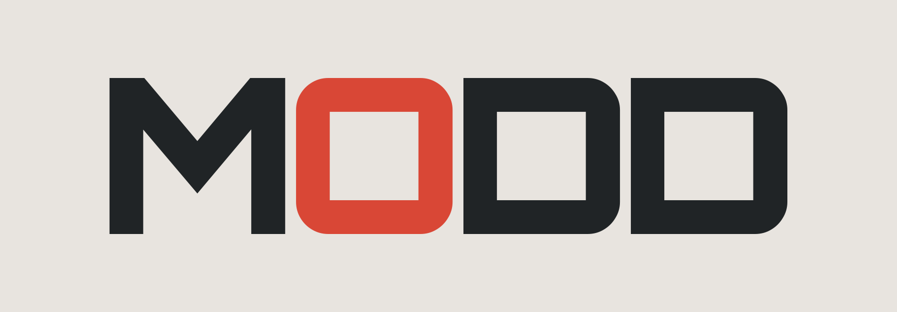
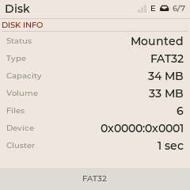
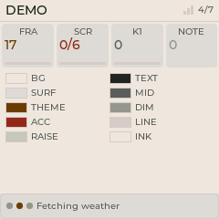
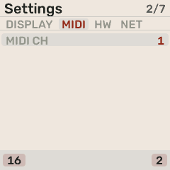
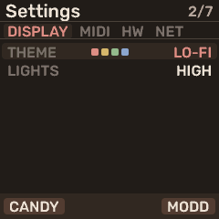

<p align="center">
  <picture>
    <source media="(prefers-color-scheme: dark)" srcset="assets/logo-dark.png">
    <source media="(prefers-color-scheme: light)" srcset="assets/logo-light.png">
    
  </picture>
</p>

<p align="center"><strong>Build FM-1 themes and firmware. Test in the emulator.</strong></p>

[](https://github.com/dimmkirr/modd/actions)
[](LICENSE)

A modular firmware framework for the M-VAVE FM-1 synthesizer. Bring features
from any FM-1 firmware into one configurable source tree: WiFi, USB tethering,
a file browser, 100+ e2e tests, and a theming system. Two themes ship today
(modd, Felucca) and nine community firmwares are vendored for
reference and reuse.

### How modd compares

Most FM-1 firmwares are monoliths: you use all of one or none of it.
modd's [adapter contracts](firmware/adapters/) and
[Kconfig build system](Kconfig) let you mix modules from different
firmwares, enable WiFi or USB storage, and test the result in the
emulator. The default build uses Melodee's audio core with FMLab's FM6
and four Felucca-Engines.

See the [full comparison](docs/COMPARISON.md) against all 8 community
firmwares, covering connectivity, audio engines, theming, testing,
and modularity.

## Features

### Adapter contracts

28 [`modd_*.h`](firmware/adapters/) headers define every interface between
modules: audio state, MIDI events, network status, settings, storage, dock
modules, USB audio, BLE, OTA. No other FM-1 firmware defines a comparable set of
inter-module contracts. Your theme or engine reads firmware state through
contracts, never hardware registers.

### Emulator-first development

Build and test firmware in the browser. The WASM emulator runs the real binary
with a virtual panel (14 buttons, 7 encoders, 1 pot). 100+ Playwright e2e tests
across 11 categories verify LCD state, button behavior, and network flows. CI
publishes screenshots on every push.

```sh
task test:e2e    # build, boot in emulator, run tests, capture screenshots
```

### Connectivity

- **WiFi**: WPA2-PSK STA, RF calibration, SDIO transport ([20 files](firmware/src/wifi/))
- **USB tethering**: Apple USB tethering (ipheth) for wired networking via iPhone<sup>1</sup> ([usbnet.c](firmware/src/net/usbnet.c))
- **USB disk**: FAT filesystem, mass storage, hub enumeration ([firmware/src/udisk/](firmware/src/udisk/))
- **List widget**: scrolling list over any source: USB directory, dock instruments, HTTP index ([modd_list.h](firmware/adapters/modd_list.h))

Link priority election (wired > WiFi > tethering), async HTTP, weather
pixel-art, and LLM inference run on top of lwIP. The WiFi driver's RF and
hardware layers are
[clean-room](docs/hardware/wifi/CLEAN_ROOM_METHODOLOGY.md) from register specs
and protocol documentation; upper layers use public standards and
permissive-licensed code (see the
[layer table](docs/hardware/wifi/CLEAN_ROOM_METHODOLOGY.md#layers-and-their-sources)).

### Theming system

Implement three render hooks (`render_header`, `render_footer`, `render_card`),
map buttons to views with a declarative controls struct, add pages with toast
notifications and scrolling lists. Auto-generated docs with e2e screenshots
verify your theme in CI. Two themes ship: modd (native with widget library)
and Felucca (ported from hugelton's firmware). Melodee provides the graphics
primitives (renderer, fonts, palettes) that the modd theme builds on.

- Theme vtable: [`firmware/src/ui/ui_theme.h`](firmware/src/ui/ui_theme.h)
- Per-theme controls: [`firmware/src/ui/themes/modd/controls.c`](firmware/src/ui/themes/modd/controls.c)
- Theme docs: [`docs/ui/themes/`](docs/ui/themes/)

<!-- theme-screenshots:start -->
<p>
  
  
  
  
  
  
</p>

<details><summary>Settings tabs</summary>
<p>
  
  
  
  
</p>
</details>

<details><summary>Color palettes</summary>
<p>
  
  
  
  
  
  
  
  
  
  
</p>
</details>
<!-- theme-screenshots:end -->

Screenshots are captured automatically during e2e tests. CI publishes the
latest set on every push. See the [full screenshot gallery](docs/ui/themes/modd/THEME.md).

<sup>1</sup> iPhone tethering is still being tested.

## Quick start

Install [mise](https://mise.jdx.dev/getting-started.html), then:

```sh
git clone https://github.com/dimmkirr/modd && cd modd
mise trust && mise install
mise exec -- uv sync --locked
mise exec -- task build
mise exec -- task test:e2e          # see your firmware in the emulator
```

The build downloads the JieLi toolchain and SDK when needed and writes
`build/modd.fwsc`. The compiler runs on x86-64 Linux; macOS builds use Docker,
and ARM Linux uses QEMU.

> **Early development:** the modd theme builds and boots in the emulator.
> Audio integration and musical workflows are still in progress.

## Move modules around

1. **Enable or disable a module.** Run `task config`, toggle a `CONFIG_*`
   symbol, rebuild. This is how you add WiFi, BLE, or an extra engine.
2. **Swap an upstream implementation.** Kconfig radio choices select which
   upstream provides a module (e.g. `CONFIG_HAL_SYS_MELODEE` vs
   `CONFIG_HAL_SYS_FELUCCA`). The adapter contract stays the same.
3. **Add your own module.** Write a `.c` file that conforms to the relevant
   `modd_*.h` contract, add a `CONFIG_*` guard, wire it into `modd.c`.
   See [AGENTS.md](AGENTS.md) for the full walkthrough.

## Testing

Two layers, both via Taskfile:

| Layer | Command | What it covers |
|-------|---------|----------------|
| Unit | `task test:unit` | Config generation, packaging, tooling |
| E2E | `task test:e2e` | Emulator boot, UI interaction, LCD assertions, screenshots |

100+ e2e and 400+ unit tests across 11 categories: audio, BLE, boot, build,
RPC, debug, dock, network, UI, USB, and WiFi. See
[docs/TESTING.md](docs/TESTING.md).

## Vendored upstreams

Nine community firmwares pinned via [vendir](vendir.yml):
[Felucca](https://github.com/hugelton/Felucca),
[Melodee](https://github.com/keremimo/melodee),
[SLOOP](https://github.com/isod89/sloop-fm1),
[JIANT](https://github.com/juanjiant-bit/JIANT),
[FMLab](https://github.com/jsmith13/fm_lab),
[fm1-dock](https://github.com/joakimeriksson/fm1-dock),
[Skiff](https://github.com/illuminus5/skiff),
[Optimist](https://github.com/w0ts/optimist),
and [fm1-base](https://github.com/charlesvestal/fm1-base).
Plus [lwIP](https://github.com/lwip-tcpip/lwip) and FatFs.

Any FM-1 firmware that builds with the JieLi toolchain can be added the same
way. See [AGENTS.md](AGENTS.md#adding-upstream-firmware) for the steps.

## Contribute

Help build a theme, integrate an engine or module, or add tests for a
supported combination. Include the configuration and test results with your
contribution, and retain upstream credits and license notices. Start with:

- [Theme vtable](firmware/src/ui/ui_theme.h) and [existing themes](firmware/src/ui/themes/)
- [Adapter contracts](firmware/adapters/) (`modd_*.h` headers)
- [Configuration](Kconfig) and [firmware entry point](firmware/src/modd.c)
- [Build tasks](Taskfile.yml)

Looking for ready-to-flash firmware with working audio? See the
[FM-1 community firmware catalog](https://github.com/aroum/fm1-custom-fw)
for Felucca, Melodee, SLOOP, and other standalone builds.

## Credits and license

Built on the work of the FM-1 community:

| Author | Contribution |
|--------|-------------|
| [hugelton](https://github.com/hugelton) | [Felucca](https://github.com/hugelton/Felucca) firmware and [Felucca-Engines](https://github.com/hugelton/Felucca-Engines) (MIT) |
| [keremimo](https://github.com/keremimo) | [Melodee](https://github.com/keremimo/melodee) firmware |
| [isod89](https://github.com/isod89) | [SLOOP](https://github.com/isod89/sloop-fm1) firmware |
| [juanjiant-bit](https://github.com/juanjiant-bit) | [JIANT](https://github.com/juanjiant-bit/JIANT) firmware |
| [joakimeriksson](https://github.com/joakimeriksson) | [fm1-dock](https://github.com/joakimeriksson/fm1-dock) module host, debug DAP, deploy tools; [fm1-emu](https://github.com/joakimeriksson/fm1-emu) FM-1 emulator |
| [charlesvestal](https://github.com/charlesvestal) | [fm1-base](https://github.com/charlesvestal/fm1-base) WiFi reference (MPL-2.0) |
| [jsmith13](https://github.com/jsmith13) | [FMLab](https://github.com/jsmith13/fm_lab) FM6 engine |
| [illuminus5](https://github.com/illuminus5) | [Skiff](https://github.com/illuminus5/skiff) firmware |
| [w0ts](https://github.com/w0ts) | [Optimist](https://github.com/w0ts/optimist) modular synth platform (29 engines, BLE, WiFi) |

[GPL-3.0-only](LICENSE). Components with other licenses retain their notices;
see [Third-party components](THIRD_PARTY.md).
