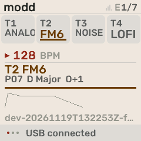

<p align="center">
  <picture>
    <source media="(prefers-color-scheme: dark)" srcset="assets/logo-dark.png">
    <source media="(prefers-color-scheme: light)" srcset="assets/logo-light.png">
    
  </picture>
</p>

<p align="center"><strong>Build FM-1 themes and firmware. Test in the emulator.</strong></p>

[](https://github.com/dimmkirr/modd/actions)
[](LICENSE)

A modular firmware framework for the M-VAVE FM-1 synthesizer. Bring features
from any FM-1 firmware into one configurable source tree: WiFi, USB Ethernet,
a file browser, 500+ e2e tests, and a theming system. Three themes ship today
(modd, Felucca, Melodee) and nine community firmwares are vendored for
reference and reuse.

### How modd compares

No FM-1 firmware combines networking, storage, testing, and a build system
that lets you mix modules from different firmwares. modd fills that gap: the
default build already runs Melodee's audio core with FMLab's FM6, four
Felucca-Engines, and modd's WiFi stack.

#### Infrastructure and connectivity

modd is the only FM-1 firmware with general-purpose networking, a USB file
browser, and a USB hub that handles both MIDI and mass storage. WiFi, USB
Ethernet, and the file browser were written
[clean-room](docs/hardware/wifi/CLEAN_ROOM_METHODOLOGY.md) from register
specs and protocol documentation.

|  | [modd](https://github.com/dimmkirr/modd) | [Felucca](https://github.com/hugelton/Felucca) | [Melodee](https://github.com/keremimo/melodee) | [SLOOP](https://github.com/isod89/sloop-fm1) | [JIANT](https://github.com/juanjiant-bit/JIANT) | [Optimist](https://github.com/w0ts/optimist) | [fm1-base](https://github.com/charlesvestal/fm1-base) | [fm1-dock](https://github.com/joakimeriksson/fm1-dock) |
|--|:----:|:-------:|:-------:|:-----:|:-----:|:--------:|:--------:|:--------:|
| WiFi (general networking) | [**Yes**](firmware/src/wifi/), [clean-room](docs/hardware/wifi/CLEAN_ROOM_METHODOLOGY.md) | No | No | No | No | [Yes](https://github.com/w0ts/optimist/blob/8e1a4e3f089caa36533d49cbe783ecea7819bd7f/firmware/src/wifi/wifi_sta.c#L1), [WPA2 radio only](https://github.com/w0ts/optimist/blob/8e1a4e3f089caa36533d49cbe783ecea7819bd7f/firmware/src/wifi/wifi_ip.h#L2) | [Yes](https://github.com/charlesvestal/fm1-base/blob/c8e05997ce970875038156d2bbd69e712eac1543/device/wifi.c#L3), [link stubs](https://github.com/charlesvestal/fm1-base/blob/c8e05997ce970875038156d2bbd69e712eac1543/ble/wifi/wifi_shim.c#L7) | No |
| USB Ethernet / tethering | [**Yes**](firmware/src/net/usbnet.c) | No | No | No | No | No | No | No |
| USB MIDI host | [**Yes**](firmware/src/udisk/usb_host_enum.c) | [Yes](https://github.com/hugelton/felucca-bsp/blob/5942e68b89ab9ccd23f2c541d712ca38fe635f11/chip/usb_host.c) | [Yes](https://github.com/keremimo/melodee/blob/v1.6.1/firmware/src/usb_host.c) | No | No | No | [Yes](https://github.com/charlesvestal/fm1-base/blob/c8e05997ce970875038156d2bbd69e712eac1543/bsp/chip/usb_host.c) | No |
| USB Audio (UAC) | [**Yes**](firmware/src/midi/usb.c), [duplex](firmware/src/midi/usb.c) | [Yes](https://github.com/hugelton/Felucca/blob/v1.8.2/firmware/bsp/chip/usb.c#L17), [record + optional playback](https://github.com/hugelton/Felucca/blob/v1.8.2/firmware/bsp/chip/usb.c#L27) | [Yes](https://github.com/keremimo/melodee/blob/v1.6.1/firmware/src/usb.c#L14), [duplex, optional](https://github.com/keremimo/melodee/blob/v1.6.1/firmware/src/usb.c#L28) | [Yes](https://github.com/isod89/sloop-fm1/blob/v2.8.5/firmware/src/usb.c#L11), [record only](https://github.com/isod89/sloop-fm1/blob/v2.8.5/firmware/src/usb.c#L11) | [Yes](https://github.com/juanjiant-bit/JIANT/blob/da8baa1eed7c4e75f1ed9bcf433797b3aeace107/firmware/src/usb.c#L16), [record only](https://github.com/juanjiant-bit/JIANT/blob/da8baa1eed7c4e75f1ed9bcf433797b3aeace107/firmware/src/usb.c#L16) | [Yes](https://github.com/w0ts/optimist/blob/8e1a4e3f089caa36533d49cbe783ecea7819bd7f/firmware/src/felucca.c#L50), [experimental](https://github.com/w0ts/optimist/blob/8e1a4e3f089caa36533d49cbe783ecea7819bd7f/firmware/src/felucca.c#L50) | No | [Yes](https://github.com/joakimeriksson/fm1-dock/blob/v0.9.0/firmware/src/usb.c#L11), [record only](https://github.com/joakimeriksson/fm1-dock/blob/v0.9.0/firmware/src/usb.c#L11) |
| USB disk | [**Yes**](firmware/src/udisk/) | No | No | No | No | [Yes](https://github.com/w0ts/optimist/blob/8e1a4e3f089caa36533d49cbe783ecea7819bd7f/firmware/src/storage/sd/sd_save.c#L274), [SD card](https://github.com/w0ts/optimist/blob/8e1a4e3f089caa36533d49cbe783ecea7819bd7f/firmware/src/storage/sd/sd_save.c#L274) | No | No |
| File browser | [**Yes**](firmware/src/udisk/) | No | [Yes](https://github.com/keremimo/melodee/blob/v1.6.1/firmware/src/browse.c#L3), [flash presets](https://github.com/keremimo/melodee/blob/v1.6.1/firmware/src/browse.c#L3) | No | No | [Yes](https://github.com/w0ts/optimist/blob/8e1a4e3f089caa36533d49cbe783ecea7819bd7f/firmware/src/ui/optimist/op_sdbrowse.c#L1), [SD card](https://github.com/w0ts/optimist/blob/8e1a4e3f089caa36533d49cbe783ecea7819bd7f/firmware/src/ui/optimist/op_sdbrowse.c#L1) | No | No |
| Theming | [**Yes**](firmware/src/ui/ui_theme.h), [vtable](firmware/src/ui/ui_theme.h) | [Yes](https://github.com/hugelton/Felucca/blob/v1.8.2/firmware/src/gfx.c#L23), [palette](https://github.com/hugelton/Felucca/blob/v1.8.2/firmware/src/gfx.c#L23) | [Yes](https://github.com/keremimo/melodee/blob/v1.6.1/firmware/src/gfx.c#L30), [palette](https://github.com/keremimo/melodee/blob/v1.6.1/firmware/src/gfx.c#L30) | [Yes](https://github.com/isod89/sloop-fm1/blob/v2.8.5/firmware/src/gfx.c#L45), [palette + user themes](https://github.com/isod89/sloop-fm1/blob/v2.8.5/firmware/src/gfx.c#L65) | [Yes](https://github.com/juanjiant-bit/JIANT/blob/da8baa1eed7c4e75f1ed9bcf433797b3aeace107/firmware/src/gfx.c#L27), [palettes + skins](https://github.com/juanjiant-bit/JIANT/blob/da8baa1eed7c4e75f1ed9bcf433797b3aeace107/firmware/src/gfx.c#L123) | No | No | [Yes](https://github.com/joakimeriksson/fm1-dock/blob/v0.9.0/firmware/src/gfx.c#L33), [palette](https://github.com/joakimeriksson/fm1-dock/blob/v0.9.0/firmware/src/gfx.c#L33) |
| Kconfig build system | [**Yes**](Kconfig) | No | [Yes](https://github.com/keremimo/melodee/blob/v1.6.1/firmware/src/build_options.h), [`build_options.h`](https://github.com/keremimo/melodee/blob/v1.6.1/firmware/src/build_options.h) | No | No | [Yes](https://github.com/w0ts/optimist/blob/8e1a4e3f089caa36533d49cbe783ecea7819bd7f/config/profiles/synths.config), [config profiles](https://github.com/w0ts/optimist/blob/8e1a4e3f089caa36533d49cbe783ecea7819bd7f/config/profiles/synths.config) | [Yes](https://github.com/charlesvestal/fm1-base/blob/c8e05997ce970875038156d2bbd69e712eac1543/include/fm1b_config.h), [`fm1b_config.h`](https://github.com/charlesvestal/fm1-base/blob/c8e05997ce970875038156d2bbd69e712eac1543/include/fm1b_config.h) | No |
| USB hub support | [**Yes**](firmware/src/udisk/usb_hub.c) | [Yes](https://github.com/hugelton/felucca-bsp/blob/5942e68b89ab9ccd23f2c541d712ca38fe635f11/chip/usb_host.c#L145), [MIDI only](https://github.com/hugelton/felucca-bsp/blob/5942e68b89ab9ccd23f2c541d712ca38fe635f11/chip/usb_host.c#L174) | [Yes](https://github.com/keremimo/melodee/blob/v1.6.1/firmware/src/usb_host.c#L35), [multi-level, MIDI only](https://github.com/keremimo/melodee/blob/v1.6.1/firmware/src/usb_host.c#L155) | No | No | No | [Yes](https://github.com/charlesvestal/fm1-base/blob/c8e05997ce970875038156d2bbd69e712eac1543/bsp/chip/usb_host.c#L182) | No |
| Dock modules | [**Experimental**](firmware/src/dock/) | No | No | No | No | No | No | [**Yes**](https://github.com/joakimeriksson/fm1-dock/blob/v0.9.0/firmware/src/dock.c), [23 modules](https://github.com/joakimeriksson/fm1-dock/tree/v0.9.0/modules) |

> Comparison verified 2026-11-17 against vendored commits. Corrections welcome via PR.

<details><summary>Feature details</summary>

- **Optimist** has a full WPA2 STA radio driver ([`wifi_sta.c`](https://github.com/w0ts/optimist/blob/8e1a4e3f089caa36533d49cbe783ecea7819bd7f/firmware/src/wifi/wifi_sta.c#L1)),
  but its IP layer is [built exclusively for Ableton Link](https://github.com/w0ts/optimist/blob/8e1a4e3f089caa36533d49cbe783ecea7819bd7f/firmware/src/wifi/wifi_ip.h#L2)
  multicast and [depends on fm1base](https://github.com/w0ts/optimist/blob/8e1a4e3f089caa36533d49cbe783ecea7819bd7f/firmware/src/wifi/wifi_ip.h#L11).
  It cannot do HTTP, weather, or general TCP/IP.
- **fm1-base** provides [link-layer stubs](https://github.com/charlesvestal/fm1-base/blob/c8e05997ce970875038156d2bbd69e712eac1543/ble/wifi/wifi_shim.c#L7)
  that satisfy the JieLi SDK's binary WiFi libs, plus a
  [STA join/scan layer](https://github.com/charlesvestal/fm1-base/blob/c8e05997ce970875038156d2bbd69e712eac1543/device/wifi.c#L3).
  Applications supply their own network code via lwIP sockets.
- **Felucca** has a [USB host driver](https://github.com/hugelton/felucca-bsp/blob/5942e68b89ab9ccd23f2c541d712ca38fe635f11/chip/usb_host.c),
  but it only enumerates MIDI devices: no FatFs, no mass storage class, no file UI.
- **Melodee**'s [`browse.c`](https://github.com/keremimo/melodee/blob/v1.6.1/firmware/src/browse.c#L3)
  navigates engine presets stored in flash, not files on a USB disk or SD card.
- **Optimist** has a full [SD-card stack](https://github.com/w0ts/optimist/blob/8e1a4e3f089caa36533d49cbe783ecea7819bd7f/firmware/src/storage/sd/sd_save.c#L274)
  with [Petit FatFs](https://github.com/w0ts/optimist/blob/8e1a4e3f089caa36533d49cbe783ecea7819bd7f/firmware/src/storage/sd/sd_save.c#L274)
  and an [SD browser UI](https://github.com/w0ts/optimist/blob/8e1a4e3f089caa36533d49cbe783ecea7819bd7f/firmware/src/ui/optimist/op_sdbrowse.c#L1),
  but no USB mass storage or hub enumeration.
- **Theming**: every firmware except Optimist and fm1-base has a colour palette system.
  modd is the only one with [vtable-based theming](firmware/src/ui/ui_theme.h) (swappable layout and widget rendering).
  SLOOP adds [user-uploadable themes](https://github.com/isod89/sloop-fm1/blob/v2.8.5/firmware/src/gfx.c#L65) via a web editor.
  JIANT has [skins](https://github.com/juanjiant-bit/JIANT/blob/da8baa1eed7c4e75f1ed9bcf433797b3aeace107/firmware/src/gfx.c#L123) that change rendering mode (HUD, AIR), not just colours.
- **USB MIDI host**: Felucca, Melodee, and fm1-base can receive from external
  USB MIDI controllers (keyboards, pads). Their USB host driver only recognises
  MIDI class devices: plug in a USB disk and nothing happens.
  modd's USB host handles both MIDI and mass storage.
- **USB hubs**: modd, Felucca, Melodee, and fm1-base enumerate USB hubs.
  Felucca and Melodee's hubs only find MIDI devices behind them.
  Melodee supports [multi-level hubs](https://github.com/keremimo/melodee/blob/v1.6.1/firmware/src/usb_host.c#L155).
  SLOOP, JIANT, Optimist, and fm1-dock have no hub driver.
- **Dock modules**: [fm1-dock](https://github.com/joakimeriksson/fm1-dock) is the
  origin of `.dock` instrument modules (23 ship with it). modd has experimental
  support: ABI tables, header/CRC/relocation, flash install from USB disk,
  and panel key routing.
- **Build systems**: Melodee uses [`build_options.h`](https://github.com/keremimo/melodee/blob/v1.6.1/firmware/src/build_options.h)
  `#ifndef` toggles. Optimist uses [key=value config profiles](https://github.com/w0ts/optimist/blob/8e1a4e3f089caa36533d49cbe783ecea7819bd7f/config/profiles/synths.config).
  fm1-base uses [`fm1b_config.h`](https://github.com/charlesvestal/fm1-base/blob/c8e05997ce970875038156d2bbd69e712eac1543/include/fm1b_config.h)
  `APP_*` overrides. None use Kconfig's dependency resolution, menuconfig TUI,
  or defconfig presets.

</details>

#### Audio, synthesis, and wireless

Audio engines plug in through the [`engine_t` vtable](firmware/adapters/modd_engine.h).
The default build runs Melodee's audio core with engines from three upstreams.

|  | modd | Felucca | Melodee | SLOOP | JIANT | Optimist | fm1-base | fm1-dock |
|--|:----:|:-------:|:-------:|:-----:|:-----:|:--------:|:--------:|:--------:|
| Audio engines | [5 engines](firmware/src/audio/engines/engines.c), 3 upstreams | [15 engines](https://github.com/hugelton/Felucca/blob/v1.8.2/firmware/src/engines.c#L28) | [6-13 engines](https://github.com/keremimo/melodee/blob/v1.6.1/firmware/src/engines.c#L102) | [12 engines](https://github.com/isod89/sloop-fm1/blob/v2.8.5/firmware/src/engines.c#L91) | [10 engines](https://github.com/juanjiant-bit/JIANT/blob/da8baa1eed7c4e75f1ed9bcf433797b3aeace107/firmware/src/engines.c#L49) | [**29 engines**](https://github.com/w0ts/optimist/blob/8e1a4e3f089caa36533d49cbe783ecea7819bd7f/firmware/src/core/registry.h#L146) | [template](https://github.com/charlesvestal/fm1-base/blob/c8e05997ce970875038156d2bbd69e712eac1543/template/app.c#L27) | [23 .dock modules](https://github.com/joakimeriksson/fm1-dock/tree/v0.9.0/modules) |
| Voice budget | -- | [8v, 4 parts](https://github.com/hugelton/Felucca/blob/v1.8.2/firmware/src/core.h#L11) | [**18 units**, FPU](https://github.com/keremimo/melodee/blob/v1.6.1/firmware/src/core.h#L17) | [8v, 3 parts](https://github.com/isod89/sloop-fm1/blob/v2.8.5/firmware/src/core.h#L9) | [8v, 6 tracks](https://github.com/juanjiant-bit/JIANT/blob/da8baa1eed7c4e75f1ed9bcf433797b3aeace107/firmware/src/core.h#L12) | [8v, 4 tracks](https://github.com/w0ts/optimist/blob/8e1a4e3f089caa36533d49cbe783ecea7819bd7f/firmware/src/core/core.h#L10) | [1 voice](https://github.com/charlesvestal/fm1-base/blob/c8e05997ce970875038156d2bbd69e712eac1543/template/app.c#L29) | per module |
| BLE MIDI | -- | -- | [**Yes**](https://github.com/keremimo/melodee/blob/v1.6.1/firmware/src/ble/ble_midi.c#L2) | -- | -- | [**Yes**](https://github.com/w0ts/optimist/blob/8e1a4e3f089caa36533d49cbe783ecea7819bd7f/firmware/src/ble/ble_midi.c#L2) | [**Yes**](https://github.com/charlesvestal/fm1-base/blob/c8e05997ce970875038156d2bbd69e712eac1543/ble/midi/le_midi.c#L8) | [**Yes**](https://github.com/joakimeriksson/fm1-dock/tree/v0.9.0/firmware/src/ble) |
| Song/track workflow | -- | [4 tracks](https://github.com/hugelton/Felucca/blob/v1.8.2/firmware/src/seq.c#L6) | [4 parts + MIDI](https://github.com/keremimo/melodee/blob/v1.6.1/firmware/src/core.h#L19) | [4 tracks](https://github.com/isod89/sloop-fm1/blob/v2.8.5/firmware/src/seq.c#L3) | [**6 tracks + song**](https://github.com/juanjiant-bit/JIANT/blob/da8baa1eed7c4e75f1ed9bcf433797b3aeace107/firmware/src/song_main.c) | [4 tracks](https://github.com/w0ts/optimist/blob/8e1a4e3f089caa36533d49cbe783ecea7819bd7f/firmware/src/core/core.h#L22) | -- | -- |
| Emulator / tests | **500+ e2e** | [74 unit](https://github.com/hugelton/Felucca/tree/v1.8.2/tests) | [228 unit](https://github.com/keremimo/melodee/tree/v1.6.1/tests) | [58 unit](https://github.com/isod89/sloop-fm1/tree/v2.8.5/tests) | [69 unit](https://github.com/juanjiant-bit/JIANT/tree/da8baa1eed7c4e75f1ed9bcf433797b3aeace107/tests) + [emu](https://github.com/juanjiant-bit/JIANT/blob/da8baa1eed7c4e75f1ed9bcf433797b3aeace107/web/emu/build.sh) | [**345 unit**](https://github.com/w0ts/optimist/tree/8e1a4e3f089caa36533d49cbe783ecea7819bd7f/tests) + [sim](https://github.com/w0ts/optimist/blob/8e1a4e3f089caa36533d49cbe783ecea7819bd7f/firmware/sim/sim.c#L1) | [96 unit](https://github.com/charlesvestal/fm1-base/tree/c8e05997ce970875038156d2bbd69e712eac1543/tests) + [sim](https://github.com/charlesvestal/fm1-base/blob/c8e05997ce970875038156d2bbd69e712eac1543/host/plat_host.c#L3) | [15 tests](https://github.com/joakimeriksson/fm1-dock/tree/v0.9.0/tests) |

> modd's e2e tests run real firmware in a [WASM emulator](https://github.com/joakimeriksson/fm1-emu)
> with Playwright: they click buttons, turn encoders, and assert LCD pixels.
> Other firmwares test with host-compiled C unit tests or Python scripts,
> which cover logic but not the rendered UI.
> [Optimist](https://github.com/w0ts/optimist/blob/8e1a4e3f089caa36533d49cbe783ecea7819bd7f/firmware/sim/sim.c#L1) and
> [fm1-base](https://github.com/charlesvestal/fm1-base/blob/c8e05997ce970875038156d2bbd69e712eac1543/host/plat_host.c#L3) have host simulators;
> [JIANT](https://github.com/juanjiant-bit/JIANT/blob/da8baa1eed7c4e75f1ed9bcf433797b3aeace107/web/emu/build.sh) has a WASM emulator build.

#### Why not just use one of them?

The three closest alternatives each solve a different piece but not the
composition problem:

- **Optimist** has 29 engines, BLE, a WiFi radio, and 555 tests, but its
  [WiFi IP layer is hardwired to Ableton Link](https://github.com/w0ts/optimist/blob/8e1a4e3f089caa36533d49cbe783ecea7819bd7f/firmware/src/wifi/wifi_ip.h#L2)
  (no HTTP, no general TCP/IP), its
  [config profiles](https://github.com/w0ts/optimist/blob/8e1a4e3f089caa36533d49cbe783ecea7819bd7f/config/profiles/synths.config)
  have no dependency resolution, and there is no way to swap in a module from
  another firmware.
- **Melodee** sets the audio bar with an
  [18-unit FPU voice budget](https://github.com/keremimo/melodee/blob/v1.6.1/firmware/src/core.h#L17)
  and 12-14 engines, but its architecture is a monolith: engines depend on
  Melodee-specific globals, and
  [`build_options.h`](https://github.com/keremimo/melodee/blob/v1.6.1/firmware/src/build_options.h)
  toggles are all-or-nothing `#ifndef` flags with no dependency graph.
- **fm1-base** is explicitly a framework, but the foundation is thin: WiFi is
  [link-layer stubs](https://github.com/charlesvestal/fm1-base/blob/c8e05997ce970875038156d2bbd69e712eac1543/ble/wifi/wifi_shim.c#L7),
  audio is a
  [1-voice template](https://github.com/charlesvestal/fm1-base/blob/c8e05997ce970875038156d2bbd69e712eac1543/template/app.c#L27),
  and there are no adapter contracts or Kconfig for mixing upstream modules.

Most FM-1 firmwares are monoliths: you use all of one or none of it. modd's
[adapter contracts](firmware/adapters/) and [Kconfig build system](Kconfig)
make mixing possible: swap an audio core, add an engine from a different
firmware, enable WiFi, and test the combination in the emulator, all by
toggling Kconfig symbols.

## Features

### Adapter contracts

28 [`modd_*.h`](firmware/adapters/) headers define every interface between
modules: audio state, MIDI events, network status, settings, storage, dock
modules, USB audio, BLE, OTA. No other FM-1 firmware defines formal
inter-module interfaces. Your theme or engine reads firmware state through
contracts, never hardware registers.

### Emulator-first development

Build and test firmware in the browser. The WASM emulator runs the real binary
with a virtual panel (14 buttons, 7 encoders, 1 pot). 500+ Playwright tests
across 11 categories verify LCD state, button behavior, and network flows. CI
publishes screenshots on every push.

```sh
task test:e2e    # build, boot in emulator, run tests, capture screenshots
```

### Connectivity

- **WiFi**: WPA2-PSK STA, RF calibration, SDIO transport ([15+ files](firmware/src/wifi/))
- **USB Ethernet**: CDC-ECM for wired networking and iPhone tethering<sup>1</sup> ([usbnet.c](firmware/src/net/usbnet.c))
- **USB disk**: FAT filesystem, mass storage, hub enumeration ([firmware/src/udisk/](firmware/src/udisk/))
- **List widget**: scrolling list over any source: USB directory, dock instruments, HTTP index ([modd_list.h](firmware/adapters/modd_list.h))

Link priority election (wired > WiFi > tethering), async HTTP, weather
pixel-art, and LLM inference run on top of lwIP. All connectivity code is
[clean-room](docs/hardware/wifi/CLEAN_ROOM_METHODOLOGY.md), written from
register specs and protocol documentation.

### Theming system

Implement three render hooks (`render_header`, `render_footer`, `render_card`),
map buttons to views with a declarative controls struct, add pages with toast
notifications and scrolling lists. Auto-generated docs with e2e screenshots
verify your theme in CI. Three themes ship: modd (native with widget library),
Felucca (ported from hugelton's firmware), and Melodee (graphics primitives).

- Theme vtable: [`firmware/src/ui/ui_theme.h`](firmware/src/ui/ui_theme.h)
- Per-theme controls: [`firmware/src/ui/themes/modd/controls.c`](firmware/src/ui/themes/modd/controls.c)
- Theme docs: [`docs/ui/themes/`](docs/ui/themes/)

<!-- theme-screenshots:start -->
<p>
  
  
</p>

<details><summary>Settings tabs</summary>
<p>
  
  
  
  
</p>
</details>

<details><summary>Color palettes (10 ship)</summary>
<p>
  
  
  
  
</p>
</details>
<!-- theme-screenshots:end -->

Screenshots are captured automatically during e2e tests. CI publishes the
latest set on every push. See [all theme screenshots](docs/ui/themes/).

<sup>1</sup> iPhone tethering is still being tested.

## Quick start

Install [mise](https://mise.jdx.dev/getting-started.html), then:

```sh
git clone https://github.com/dimmkirr/modd && cd modd
mise trust && mise install
mise exec -- uv sync --locked
mise exec -- task build
mise exec -- task test:e2e          # see your firmware in the emulator
```

The build downloads the JieLi toolchain and SDK when needed and writes
`build/modd.fwsc`. The compiler runs on x86-64 Linux; macOS builds use Docker,
and ARM Linux uses QEMU.

> **Early development:** the modd theme builds and boots in the emulator.
> Audio integration and musical workflows are still in progress.

## Move modules around

1. **Enable or disable a module.** Run `task config`, toggle a `CONFIG_*`
   symbol, rebuild. This is how you add WiFi, BLE, or an extra engine.
2. **Swap an upstream implementation.** Kconfig radio choices select which
   upstream provides a module (e.g. `CONFIG_HAL_SYS_MELODEE` vs
   `CONFIG_HAL_SYS_FELUCCA`). The adapter contract stays the same.
3. **Add your own module.** Write a `.c` file that conforms to the relevant
   `modd_*.h` contract, add a `CONFIG_*` guard, wire it into `modd.c`.
   See [AGENTS.md](AGENTS.md) for the full walkthrough.

## Testing

Two layers, both via Taskfile:

| Layer | Command | What it covers |
|-------|---------|----------------|
| Unit | `task test:unit` | Config generation, packaging, tooling |
| E2E | `task test:e2e` | Emulator boot, UI interaction, LCD assertions, screenshots |

500+ tests across 11 categories: audio, BLE, boot, build, CDP, debug, dock,
network, UI, USB, and WiFi. See [docs/TESTING.md](docs/TESTING.md).

## Vendored upstreams

Nine community firmwares pinned via [vendir](vendir.yml):
[Felucca](https://github.com/hugelton/Felucca),
[Melodee](https://github.com/keremimo/melodee),
[SLOOP](https://github.com/isod89/sloop-fm1),
[JIANT](https://github.com/juanjiant-bit/JIANT),
[FMLab](https://github.com/jsmith13/fm_lab),
[fm1-dock](https://github.com/joakimeriksson/fm1-dock),
[Skiff](https://github.com/illuminus5/skiff),
[Optimist](https://github.com/w0ts/optimist),
and [fm1-base](https://github.com/charlesvestal/fm1-base).
Plus [lwIP](https://github.com/lwip-tcpip/lwip) and FatFs.

Any FM-1 firmware that builds with the JieLi toolchain can be added the same
way. See [AGENTS.md](AGENTS.md#adding-upstream-firmware) for the steps.

## Contribute

Help build a theme, integrate an engine or module, or add tests for a
supported combination. Include the configuration and test results with your
contribution, and retain upstream credits and license notices. Start with:

- [Theme vtable](firmware/src/ui/ui_theme.h) and [existing themes](firmware/src/ui/themes/)
- [Adapter contracts](firmware/adapters/) (`modd_*.h` headers)
- [Configuration](Kconfig) and [firmware entry point](firmware/src/modd.c)
- [Build tasks](Taskfile.yml)

Looking for ready-to-flash firmware with working audio? See the
[FM-1 community firmware catalog](https://github.com/aroum/fm1-custom-fw)
for Felucca, Melodee, SLOOP, and other standalone builds.

## Credits and license

Built on the work of the FM-1 community:

| Author | Contribution |
|--------|-------------|
| [hugelton](https://github.com/hugelton) | [Felucca](https://github.com/hugelton/Felucca) firmware and [Felucca-Engines](https://github.com/hugelton/Felucca-Engines) (MIT) |
| [keremimo](https://github.com/keremimo) | [Melodee](https://github.com/keremimo/melodee) firmware |
| [isod89](https://github.com/isod89) | [SLOOP](https://github.com/isod89/sloop-fm1) firmware |
| [joakimeriksson](https://github.com/joakimeriksson) | [fm1-dock](https://github.com/joakimeriksson/fm1-dock) module host, debug DAP, deploy tools; [fm1-emu](https://github.com/joakimeriksson/fm1-emu) FM-1 emulator |
| [charlesvestal](https://github.com/charlesvestal) | [fm1-base](https://github.com/charlesvestal/fm1-base) WiFi reference (MPL-2.0) |
| [jsmith13](https://github.com/jsmith13) | [FMLab](https://github.com/jsmith13/fm_lab) FM6 engine |
| [illuminus5](https://github.com/illuminus5) | [Skiff](https://github.com/illuminus5/skiff) firmware |
| [w0ts](https://github.com/w0ts) | [Optimist](https://github.com/w0ts/optimist) BLE firmware |

[GPL-3.0-only](LICENSE). Components with other licenses retain their notices;
see [Third-party components](THIRD_PARTY.md).
