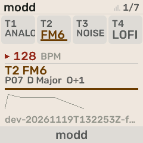
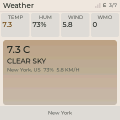
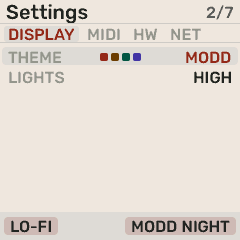
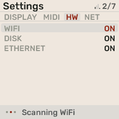
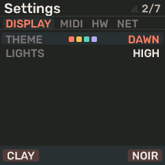
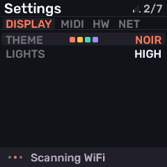
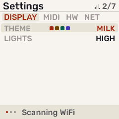
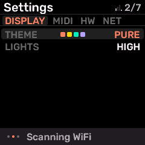
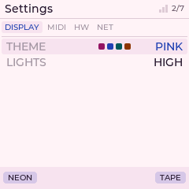

<p align="center">
  <picture>
    <source media="(prefers-color-scheme: dark)" srcset="assets/logo-dark.png">
    <source media="(prefers-color-scheme: light)" srcset="assets/logo-light.png">
    
  </picture>
</p>

<p align="center"><strong>Build FM-1 themes and firmware. Test in the emulator.</strong></p>

[](https://github.com/dimmkirr/modd/actions)
[](LICENSE)

A modular firmware framework for the M-VAVE FM-1 synthesizer. Bring modules
from any FM-1 firmware into one configurable source tree, build your own theme
or engine, and test in the browser emulator before flashing.

28 adapter contracts define every cross-module interface. Three themes and
12 build presets ship today. Nine community firmwares are vendored for reference
and reuse.

## Features

### Modular theming system

Implement three render hooks (`render_header`, `render_footer`, `render_card`),
map buttons to views with a declarative controls struct, add pages with toast
notifications and scrolling lists. Auto-generated docs with e2e screenshots
verify your theme in CI. Three themes ship: modd (native with widget library),
Felucca (ported from hugelton's firmware), and Melodee (graphics primitives).

- Theme vtable: [`firmware/src/ui/ui_theme.h`](firmware/src/ui/ui_theme.h)
- Per-theme controls: [`firmware/src/ui/themes/modd/controls.c`](firmware/src/ui/themes/modd/controls.c)
- Theme docs: [`docs/ui/themes/`](docs/ui/themes/)

### Emulator-first development

Build and test firmware in the browser. The WASM emulator runs the real binary
with a virtual panel (14 buttons, 7 encoders, 1 pot). 500+ Playwright tests
across 11 categories verify LCD state, button behavior, and network flows. CI
publishes screenshots on every push.

```sh
task test:e2e    # build, boot in emulator, run tests, capture screenshots
```

### 28 adapter contracts

Every `modd_*.h` header is a stable interface: audio state, MIDI events,
network status, settings, storage, toast, dock modules, USB audio, BLE, OTA.
Your theme reads firmware state through contracts, never hardware registers.
AI tools read one header and know what a component provides.

**Also:** [full networking stack](firmware/src/net/) ([clean-room WiFi](docs/hardware/wifi/CLEAN_ROOM_METHODOLOGY.md), lwIP,
USB Ethernet, iPhone tethering<sup>1</sup>) | [Kconfig with 12 presets](configs/)
(19 module configs, 9 vendored upstreams) | [USB disk with hub support](firmware/src/udisk/)

### Themes

<!-- theme-screenshots:start -->
<p>
  
  
</p>

<details><summary>Settings tabs</summary>
<p>
  
  
  
  
</p>
</details>

<details><summary>Color palettes</summary>
<p>
  
  
  
  
  
  
  
  
  
  
</p>
</details>
<!-- theme-screenshots:end -->

Screenshots are captured automatically during e2e tests. CI publishes the
latest set on every push. See [all theme screenshots](docs/ui/themes/).

<sup>1</sup> iPhone tethering is still being tested.

## Quick start

Install [mise](https://mise.jdx.dev/getting-started.html), then:

```sh
git clone https://github.com/dimmkirr/modd && cd modd
mise trust && mise install
mise exec -- uv sync --locked
mise exec -- task build
mise exec -- task test:e2e          # see your firmware in the emulator
```

The build downloads the JieLi toolchain and SDK when needed and writes
`build/modd.fwsc`. The compiler runs on x86-64 Linux; macOS builds use Docker,
and ARM Linux uses QEMU.

> **Early development:** the modd theme builds and boots in the emulator.
> Audio integration and musical workflows are still in progress.

## Move modules around

1. **Enable or disable a module.** Run `task config`, toggle a `CONFIG_*`
   symbol, rebuild. This is how you add WiFi, BLE, or an extra engine.
2. **Swap an upstream implementation.** Kconfig radio choices select which
   upstream provides a module (e.g. `CONFIG_HAL_SYS_MELODEE` vs
   `CONFIG_HAL_SYS_FELUCCA`). The adapter contract stays the same.
3. **Add your own module.** Write a `.c` file that conforms to the relevant
   `modd_*.h` contract, add a `CONFIG_*` guard, wire it into `modd.c`.
   See [AGENTS.md](AGENTS.md) for the full walkthrough.

## Testing

Two layers, both via Taskfile:

| Layer | Command | What it covers |
|-------|---------|----------------|
| Unit | `task test:unit` | Config generation, packaging, tooling |
| E2E | `task test:e2e` | Emulator boot, UI interaction, LCD assertions, screenshots |

500+ tests across 11 categories: audio, BLE, boot, build, CDP, debug, dock,
network, UI, USB, and WiFi. See [docs/TESTING.md](docs/TESTING.md).

## Vendored upstreams

Nine community firmwares pinned via [vendir](vendir.yml):
[Felucca](https://github.com/hugelton/Felucca),
[Melodee](https://github.com/keremimo/melodee),
[SLOOP](https://github.com/isod89/sloop-fm1),
[FMLab](https://github.com/jsmith13/fm_lab),
[fm1-dock](https://github.com/joakimeriksson/fm1-dock),
[Skiff](https://github.com/illuminus5/skiff),
[Optimist](https://github.com/w0ts/optimist),
and [fm1-base](https://github.com/charlesvestal/fm1-base).
Plus [lwIP](https://github.com/lwip-tcpip/lwip) and FatFs.

Any FM-1 firmware that builds with the JieLi toolchain can be added the same
way. See [AGENTS.md](AGENTS.md#adding-upstream-firmware) for the steps.

## Contribute

Help build a theme, integrate an engine or module, or add tests for a
supported combination. Include the configuration and test results with your
contribution, and retain upstream credits and license notices. Start with:

- [Theme vtable](firmware/src/ui/ui_theme.h) and [existing themes](firmware/src/ui/themes/)
- [Adapter contracts](firmware/adapters/) (`modd_*.h` headers)
- [Configuration](Kconfig) and [firmware entry point](firmware/src/modd.c)
- [Build tasks](Taskfile.yml)

Looking for ready-to-flash firmware with working audio? See the
[FM-1 community firmware catalog](https://github.com/aroum/fm1-custom-fw)
for Felucca, Melodee, SLOOP, and other standalone builds.

## Credits and license

Built on the work of the FM-1 community:

| Author | Contribution |
|--------|-------------|
| [hugelton](https://github.com/hugelton) | [Felucca](https://github.com/hugelton/Felucca) firmware and [Felucca-Engines](https://github.com/hugelton/Felucca-Engines) (MIT) |
| [keremimo](https://github.com/keremimo) | [Melodee](https://github.com/keremimo/melodee) firmware |
| [isod89](https://github.com/isod89) | [SLOOP](https://github.com/isod89/sloop-fm1) firmware |
| [joakimeriksson](https://github.com/joakimeriksson) | [fm1-dock](https://github.com/joakimeriksson/fm1-dock) module host, debug DAP, deploy tools; [fm1-emu](https://github.com/joakimeriksson/fm1-emu) FM-1 emulator |
| [charlesvestal](https://github.com/charlesvestal) | [fm1-base](https://github.com/charlesvestal/fm1-base) WiFi reference (MPL-2.0) |
| [jsmith13](https://github.com/jsmith13) | [FMLab](https://github.com/jsmith13/fm_lab) FM6 engine |
| [illuminus5](https://github.com/illuminus5) | [Skiff](https://github.com/illuminus5/skiff) firmware |
| [w0ts](https://github.com/w0ts) | [Optimist](https://github.com/w0ts/optimist) BLE firmware |

[GPL-3.0-only](LICENSE). Components with other licenses retain their notices;
see [Third-party components](THIRD_PARTY.md).
