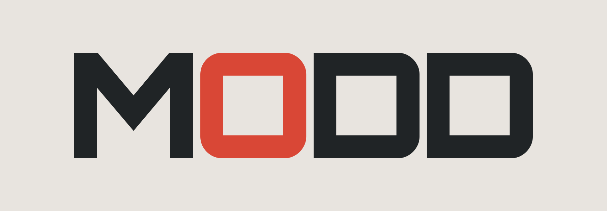

<p align="center">
  <picture>
    <source media="(prefers-color-scheme: dark)" srcset="assets/logo-dark.png">
    <source media="(prefers-color-scheme: light)" srcset="assets/logo-light.png">
    
  </picture>
</p>

<p align="center"><strong>Your FM-1. Your combination.</strong></p>

A modular firmware framework for the M-VAVE FM-1 synthesizer. Bring modules
from any FM-1 firmware into one configurable source tree and build a single
image for your instrument.

Three community firmwares are vendored today:
[Felucca](https://github.com/hugelton/Felucca),
[Melodee](https://github.com/keremimo/melodee), and
[SLOOP](https://github.com/isod89/sloop-fm1). Any FM-1 firmware that builds
with the JieLi toolchain can be added the same way.

> **Early development:** the minimal preset builds and boots in the emulator.
> Audio, engine mixing, and musical workflows are still being integrated.

## How modules work

modd compiles as a single translation unit. Kconfig controls which modules
are included via `CONFIG_*` guards:

- **Modules** are domain groupings: Audio, UI, MIDI, USB, WiFi, BLE, HAL,
  Storage, Boot, Debug.
- **Adapter contracts** (`modd_*.h` headers) define the interface between
  modules. A component from any upstream can plug in if it conforms to the
  contract.
- **Engines** implement the `engine_t` vtable (`note_on`, `render`, plus
  optional fields). They compile in or out independently via `CONFIG_ENGINE_*`.

Combinations must fit the FM-1's memory and processing budget and satisfy
module dependencies. Today, only the `minimal` preset is buildable; more
presets and engine selection are planned.

## Move modules around

Three levels, from simplest to most involved:

1. **Enable or disable a module.** Run `task config`, toggle a `CONFIG_*`
   symbol, rebuild. This is how you add WiFi, BLE, or an extra engine.
2. **Swap an upstream implementation.** Kconfig radio choices select which
   upstream provides a module (e.g. `CONFIG_HAL_SYS_MELODEE` vs
   `CONFIG_HAL_SYS_FELUCCA`). The adapter contract stays the same.
3. **Add your own module.** Write a `.c` file that conforms to the relevant
   `modd_*.h` contract, add a `CONFIG_*` guard, wire it into `modd.c`.
   See [AGENTS.md](AGENTS.md) for the full walkthrough.

If you want modules from multiple firmwares in one build (e.g. one engine
from Felucca, one from Melodee), the recommended path is to add them as
modules via adapters to modd.

## Test before flashing

The WASM emulator runs your firmware in the browser. E2E tests (Playwright)
interact with the virtual panel and verify LCD state, so you can iterate
without connecting hardware:

```sh
mise exec -- task test:e2e
```

See [Testing](docs/TESTING.md) for Chromium setup, test coverage, and
screenshots.

## Build the current milestone

Install [mise](https://mise.jdx.dev/getting-started.html), then run from this
checkout:

```sh
mise trust
mise install
mise exec -- uv sync --locked
mise exec -- task config:generate:defconfig -- minimal
mise exec -- task build
```

The build downloads the SDK and JieLi toolchain when needed and writes
`build/modd.fwsc`. On first use, Task asks you to trust its remote setup
Taskfiles. The compiler runs on x86-64 Linux; macOS builds use Docker, and
supported ARM Linux setups use QEMU.

To inspect the build without compiling, run `mise exec -- task build:dry-run`.
To explore the configuration menus, run `mise exec -- task config`. Some menu
choices are placeholders: the build rejects unintegrated options. Reload
`minimal` to return to the supported configuration.

## Contribute

Help integrate an engine or module, define its compatibility requirements,
or add tests for a supported combination. Include the configuration and test
results with your contribution, and retain upstream credits and license notices.
Start with the [configuration](Kconfig), [firmware entry point](firmware/src/modd.c),
and [build tasks](Taskfile.yml).

For playable firmware available today, explore the
[FM-1 community catalog](https://github.com/aroum/fm1-custom-fw).

## Credits and license

Built on the work of **hugelton** (Felucca), **keremimo** (Melodee), and
**isod89** (SLOOP), with **aroum** maintaining the community firmware catalog.

[GPL-3.0-only](LICENSE). Components with other licenses retain their notices;
see [Third-party components](THIRD_PARTY.md).
