# Felucca UI Navigation

Auto-generated from `firmware/src/ui/shells/felucca/lvgl_pages.c` and `firmware/adapters/modd_controls.h`.

Regenerate: `task docs:ui-map -- felucca`

- **Solid arrows** (`-->`) = button tap navigation
- **Dashed arrows** (`-.->`) = button hold navigation
- **Dotted bi-arrows** (`<-..->`) = encoder cycling within a view
- **⚙ labels** = Kconfig guards (page compiled only when enabled)

```mermaid
%%{init: {"flowchart": {"curve": "linear"}} }%%
flowchart TD

    BOOT(["Boot Splash"]):::boot
    BOOT --> sg_HOME

    subgraph sg_HOME["Home"]
        P_FILES_HOME["Files<br/><small>⚙ HOME_PAGE_FILES</small>"]
        P_HOME["modd<br/><small>⚙ !HOME_PAGE_FILES</small>"]
        P_MIXER["Mixer<br/><small>⚙ AUDIO</small>"]
        P_CLOCK["Clock<br/><small>⚙ AUDIO</small>"]
        P_SONG["Song<br/><small>⚙ AUDIO</small>"]
    end

    subgraph sg_ENV["Envelope"]
        P_ENV["Envelope<br/><small>⚙ AUDIO</small>"]
        P_ENV_DEST["Env Dest<br/><small>⚙ AUDIO</small>"]
    end

    subgraph sg_LFO["LFO"]
        P_LFO["LFO<br/><small>⚙ AUDIO</small>"]
        P_LFO2["LFO 2<br/><small>⚙ AUDIO</small>"]
        P_LFO_DEST["LFO Dest<br/><small>⚙ AUDIO</small>"]
        P_MOD["Mod<br/><small>⚙ AUDIO</small>"]
    end

    subgraph sg_FX["Effects"]
        P_FX["Effects<br/><small>⚙ AUDIO</small>"]
        P_SLICER["Slicer<br/><small>⚙ AUDIO</small>"]
        P_INSERT["Insert<br/><small>⚙ AUDIO</small>"]
        P_INSERT2["Insert 2<br/><small>⚙ AUDIO</small>"]
        P_DLY["Delay<br/><small>⚙ AUDIO</small>"]
        P_REVERB["Reverb<br/><small>⚙ AUDIO</small>"]
        P_CHORUS["Chorus<br/><small>⚙ AUDIO</small>"]
    end

    subgraph sg_SCL["Scale"]
        P_SCL["Scale<br/><small>⚙ AUDIO</small>"]
        P_CHORD["Chord<br/><small>⚙ AUDIO</small>"]
    end

    subgraph sg_EDIT["Edit"]
        P_EDIT["Edit<br/><small>⚙ AUDIO</small>"]
        P_VOICE["Voice<br/><small>⚙ AUDIO</small>"]
        P_EDIT2["Edit 2<br/><small>⚙ AUDIO</small>"]
        P_FILTER["Filter<br/><small>⚙ AUDIO</small>"]
        P_VOICE2["Voice 2<br/><small>⚙ AUDIO</small>"]
        P_VOICE3["Voice 3<br/><small>⚙ AUDIO</small>"]
        P_LANES["Lanes<br/><small>⚙ AUDIO</small>"]
        P_LANES2["Lanes 2<br/><small>⚙ AUDIO</small>"]
        P_FM6_OP1_ENV["Operator 1 Env<br/><small>⚙ AUDIO</small>"]
        P_FM6_OP2_ENV["Operator 2 Env<br/><small>⚙ AUDIO</small>"]
        P_FM6_OP3_ENV["Operator 3 Env<br/><small>⚙ AUDIO</small>"]
        P_FM6_OP4_ENV["Operator 4 Env<br/><small>⚙ AUDIO</small>"]
        P_FM6_OP_LEVEL["Operator Levels<br/><small>⚙ AUDIO</small>"]
    end

    subgraph sg_GLO["Global"]
        P_ABOUT["About"]
        P_DEBUG["Log<br/><small>⚙ DEBUG_LOG_BUF</small>"]
    end

    subgraph sg_SAVE["Save"]
        P_USER["User<br/><small>⚙ AUDIO</small>"]
        P_PRESETS["Presets<br/><small>⚙ AUDIO</small>"]
        P_PHRASES["Phrases<br/><small>⚙ AUDIO</small>"]
        P_PROJECT["Project<br/><small>⚙ AUDIO</small>"]
        P_TOOLS["Tools<br/><small>⚙ AUDIO</small>"]
    end

    subgraph sg_ARP["Arpeggio"]
        P_ARP["Arpeggiator<br/><small>⚙ AUDIO</small>"]
        P_ARP2["Arp 2<br/><small>⚙ AUDIO</small>"]
    end

    subgraph sg_SEQ["Sequencer"]
        P_SEQ["Sequencer<br/><small>⚙ AUDIO</small>"]
        P_STEP["Step<br/><small>⚙ AUDIO</small>"]
        P_DETAIL["Detail<br/><small>⚙ AUDIO</small>"]
        P_AUTOMATION["Automation<br/><small>⚙ AUDIO · SEQ_FELUCCA & !CORE_FELUCCA</small>"]
    end

    subgraph sg_CONN["Connectivity"]
        P_WEATHER["Weather<br/><small>⚙ LWIP</small>"]
        P_DEMO["DEMO<br/><small>⚙ PAGE_DEMO</small>"]
    end

    subgraph sg_SETTINGS["Settings"]
        P_SETTINGS["Settings<br/><small>⚙ SYS_MENU</small>"]
        P_BRIGHTNESS["Brightness<br/><small>⚙ SYS_MENU</small>"]
        P_PALETTE["Palette<br/><small>⚙ SYS_MENU</small>"]
        P_SELECT_MODE["Select mode<br/><small>⚙ SYS_MENU</small>"]
        P_MIDI_CH["MIDI channel<br/><small>⚙ SYS_MENU</small>"]
        P_TRANSPOSE["Transpose<br/><small>⚙ SYS_MENU</small>"]
    end

    subgraph sg_DEMO["Demo"]
        P_FILES_DEMO["Files<br/><small>⚙ UDISK · !HOME_PAGE_FILES</small>"]
        P_DISK["Disk<br/><small>⚙ UDISK</small>"]
    end

    %% Encoder: cycle pages within a view
    P_HOME <-..-> P_MIXER
    P_MIXER <-..-> P_CLOCK
    P_CLOCK <-..-> P_SONG
    P_ENV <-..-> P_ENV_DEST
    P_LFO <-..-> P_LFO2
    P_LFO2 <-..-> P_LFO_DEST
    P_LFO_DEST <-..-> P_MOD
    P_FX <-..-> P_SLICER
    P_SLICER <-..-> P_INSERT
    P_INSERT <-..-> P_INSERT2
    P_INSERT2 <-..-> P_DLY
    P_DLY <-..-> P_REVERB
    P_REVERB <-..-> P_CHORUS
    P_SCL <-..-> P_CHORD
    P_EDIT <-..-> P_VOICE
    P_VOICE <-..-> P_EDIT2
    P_EDIT2 <-..-> P_FILTER
    P_FILTER <-..-> P_VOICE2
    P_VOICE2 <-..-> P_VOICE3
    P_VOICE3 <-..-> P_LANES
    P_LANES <-..-> P_LANES2
    P_LANES2 <-..-> P_FM6_OP1_ENV
    P_FM6_OP1_ENV <-..-> P_FM6_OP2_ENV
    P_FM6_OP2_ENV <-..-> P_FM6_OP3_ENV
    P_FM6_OP3_ENV <-..-> P_FM6_OP4_ENV
    P_FM6_OP4_ENV <-..-> P_FM6_OP_LEVEL
    P_SETTINGS <-..-> P_BRIGHTNESS
    P_BRIGHTNESS <-..-> P_PALETTE
    P_PALETTE <-..-> P_SELECT_MODE
    P_SELECT_MODE <-..-> P_MIDI_CH
    P_MIDI_CH <-..-> P_TRANSPOSE
    P_ARP <-..-> P_ARP2
    P_SEQ <-..-> P_STEP
    P_STEP <-..-> P_DETAIL
    P_DETAIL <-..-> P_AUTOMATION
    P_USER <-..-> P_PRESETS
    P_PRESETS <-..-> P_PHRASES
    P_PHRASES <-..-> P_PROJECT
    P_PROJECT <-..-> P_TOOLS
    P_WEATHER <-..-> P_DEMO
    P_FILES_DEMO <-..-> P_DISK
    P_ABOUT <-..-> P_DEBUG

    %% Buttons: tap navigates between views
    BTN_ARP[/"ARP"/] --> sg_ARP
    BTN_EDIT[/"EDIT"/] --> sg_EDIT
    BTN_ENV[/"ENV"/] --> sg_ENV
    BTN_FX[/"FX"/] --> sg_FX
    BTN_GLO[/"GLO"/] --> sg_GLO
    BTN_HOME[/"HOME"/] --> sg_HOME
    BTN_LFO[/"LFO"/] --> sg_LFO
    BTN_SAVE[/"SAVE"/] --> sg_SAVE
    BTN_SCL[/"SCL"/] --> sg_SCL
    BTN_SEQ[/"SEQ"/] --> sg_SEQ

    %% Buttons: hold navigates to secondary views
    BTN_FX_H[/"FX hold"/] -.-> sg_DEMO
    BTN_GLO_H[/"GLO hold"/] -.-> sg_CONN
    BTN_HOME_H[/"HOME hold"/] -.-> sg_SETTINGS

    classDef boot fill:#E8E4DF,stroke:#6E675E,color:#333
```

<!-- ui-nav-diagram:start -->

<!-- ui-nav-diagram:end -->

<!-- ui-controls-table:start -->
## Global controls

Always active, handled by the shell or keyboard overlay:

| Control | Action |
|---------|--------|
| Presets (enc) | Cycle presets |
| Master (pot) | Master volume |
| OCT+ / OCT- | Octave shift |
| PLAY | Play/stop (page-specific on WIFI, WEATHER, BLE) |
| REC | Record toggle |
| Select (enc) | Cycle pages within current view (when no page claims it) |

## Controls per page

| Page | Select | Algo | Knob 1 | Knob 2 | Knob 3 | Knob 4 | Buttons |
|------|--------|------|--------|--------|--------|--------|---------|
| [Files](../../../../firmware/src/ui/shells/modd/page_files.c#L138) | [PAGE](../../../../firmware/src/ui/shells/modd/page_files.c#L123) | [LIST](../../../../firmware/src/ui/shells/modd/page_files.c#L124) | - | - | - | - | OCTDN |
| [modd](../../../../firmware/src/ui/shells/modd/page_home.c#L166) | [TRK](../../../../firmware/src/ui/shells/modd/page_home.c#L151) | - | - | - | - | - | - |
| [Mixer](../../../../firmware/src/ui/shells/modd/page_mixer.c#L87) | [TRK](../../../../firmware/src/ui/shells/modd/page_mixer.c#L80) | - | [LVL1](../../../../firmware/src/ui/shells/modd/page_mixer.c#L81) | [LVL2](../../../../firmware/src/ui/shells/modd/page_mixer.c#L82) | [LVL3](../../../../firmware/src/ui/shells/modd/page_mixer.c#L83) | [LVL4](../../../../firmware/src/ui/shells/modd/page_mixer.c#L84) | - |
| [Clock](../../../../firmware/src/ui/shells/modd/page_knob.c#L152) | - | - | [BPM](../../../../firmware/src/ui/shells/modd/page_knob.c#L152) | [SWING](../../../../firmware/src/ui/shells/modd/page_knob.c#L152) | [CLOCK](../../../../firmware/src/ui/shells/modd/page_knob.c#L152) | - | - |
| [Song](../../../../firmware/src/ui/shells/modd/page_song.c#L28) | - | - | [BPM](../../../../firmware/src/ui/shells/modd/page_song.c#L25) | - | - | - | - |
| [Envelope](../../../../firmware/src/ui/shells/modd/page_env.c#L70) | - | - | [ATK](../../../../firmware/src/ui/shells/modd/page_env.c#L64) | [DEC](../../../../firmware/src/ui/shells/modd/page_env.c#L65) | [SUS](../../../../firmware/src/ui/shells/modd/page_env.c#L66) | [REL](../../../../firmware/src/ui/shells/modd/page_env.c#L67) | - |
| [Env Dest](../../../../firmware/src/ui/shells/modd/page_knob.c#L130) | - | - | [ED_FLT](../../../../firmware/src/ui/shells/modd/page_knob.c#L130) | [ED_PIT](../../../../firmware/src/ui/shells/modd/page_knob.c#L130) | [ED_SHP](../../../../firmware/src/ui/shells/modd/page_knob.c#L130) | [ESYNC](../../../../firmware/src/ui/shells/modd/page_knob.c#L130) | - |
| [LFO](../../../../firmware/src/ui/shells/modd/page_lfo.c#L57) | - | - | [RATE](../../../../firmware/src/ui/shells/modd/page_lfo.c#L51) | [DEPTH](../../../../firmware/src/ui/shells/modd/page_lfo.c#L52) | [SHAPE](../../../../firmware/src/ui/shells/modd/page_lfo.c#L53) | [DELAY](../../../../firmware/src/ui/shells/modd/page_lfo.c#L54) | - |
| [LFO 2](../../../../firmware/src/ui/shells/modd/page_knob.c#L131) | - | - | [LSYNC](../../../../firmware/src/ui/shells/modd/page_knob.c#L131) | [LTRIG](../../../../firmware/src/ui/shells/modd/page_knob.c#L131) | [LPOL](../../../../firmware/src/ui/shells/modd/page_knob.c#L131) | - | - |
| [LFO Dest](../../../../firmware/src/ui/shells/modd/page_knob.c#L132) | - | - | [LD_PIT](../../../../firmware/src/ui/shells/modd/page_knob.c#L132) | [LD_FLT](../../../../firmware/src/ui/shells/modd/page_knob.c#L132) | [LD_SHP](../../../../firmware/src/ui/shells/modd/page_knob.c#L132) | [LD_AMP](../../../../firmware/src/ui/shells/modd/page_knob.c#L132) | - |
| [Mod](../../../../firmware/src/ui/shells/modd/page_mod.c#L65) | - | - | [SLOT](../../../../firmware/src/ui/shells/modd/page_mod.c#L59) | [SRC](../../../../firmware/src/ui/shells/modd/page_mod.c#L60) | [DST](../../../../firmware/src/ui/shells/modd/page_mod.c#L61) | [AMT](../../../../firmware/src/ui/shells/modd/page_mod.c#L62) | - |
| [Effects](../../../../firmware/src/ui/shells/modd/page_fx.c#L37) | - | - | [DST](../../../../firmware/src/ui/shells/modd/page_fx.c#L31) | [CHO](../../../../firmware/src/ui/shells/modd/page_fx.c#L32) | [DLY](../../../../firmware/src/ui/shells/modd/page_fx.c#L33) | [REV](../../../../firmware/src/ui/shells/modd/page_fx.c#L34) | - |
| [Slicer](../../../../firmware/src/ui/shells/modd/page_knob.c#L133) | - | - | [SLCR](../../../../firmware/src/ui/shells/modd/page_knob.c#L133) | [SLPAT](../../../../firmware/src/ui/shells/modd/page_knob.c#L133) | [SLRATE](../../../../firmware/src/ui/shells/modd/page_knob.c#L133) | [SLDEPTH](../../../../firmware/src/ui/shells/modd/page_knob.c#L133) | - |
| [Insert](../../../../firmware/src/ui/shells/modd/page_knob.c#L134) | - | - | [ITYPE](../../../../firmware/src/ui/shells/modd/page_knob.c#L134) | [IA](../../../../firmware/src/ui/shells/modd/page_knob.c#L134) | [IB](../../../../firmware/src/ui/shells/modd/page_knob.c#L134) | [IC](../../../../firmware/src/ui/shells/modd/page_knob.c#L134) | - |
| [Insert 2](../../../../firmware/src/ui/shells/modd/page_knob.c#L135) | - | - | [IMIX](../../../../firmware/src/ui/shells/modd/page_knob.c#L135) | - | - | - | - |
| [Delay](../../../../firmware/src/ui/shells/modd/page_knob.c#L136) | - | - | [DTIME](../../../../firmware/src/ui/shells/modd/page_knob.c#L136) | [DFDBK](../../../../firmware/src/ui/shells/modd/page_knob.c#L136) | [DCOLOR](../../../../firmware/src/ui/shells/modd/page_knob.c#L136) | [DMIX](../../../../firmware/src/ui/shells/modd/page_knob.c#L136) | - |
| [Reverb](../../../../firmware/src/ui/shells/modd/page_knob.c#L137) | - | - | [RTYPE](../../../../firmware/src/ui/shells/modd/page_knob.c#L137) | [RSIZE](../../../../firmware/src/ui/shells/modd/page_knob.c#L137) | [RDAMP](../../../../firmware/src/ui/shells/modd/page_knob.c#L137) | - | - |
| [Chorus](../../../../firmware/src/ui/shells/modd/page_knob.c#L138) | - | - | [CRATE](../../../../firmware/src/ui/shells/modd/page_knob.c#L138) | [CDEPTH](../../../../firmware/src/ui/shells/modd/page_knob.c#L138) | - | - | - |
| [Scale](../../../../firmware/src/ui/shells/modd/page_scl.c#L65) | - | - | [ROOT](../../../../firmware/src/ui/shells/modd/page_scl.c#L59) | [SCALE](../../../../firmware/src/ui/shells/modd/page_scl.c#L60) | [OCT](../../../../firmware/src/ui/shells/modd/page_scl.c#L61) | [TRANS](../../../../firmware/src/ui/shells/modd/page_scl.c#L62) | - |
| [Chord](../../../../firmware/src/ui/shells/modd/page_knob.c#L139) | - | - | [CHRD](../../../../firmware/src/ui/shells/modd/page_knob.c#L139) | [VOIC](../../../../firmware/src/ui/shells/modd/page_knob.c#L139) | - | - | - |
| [Edit](../../../../firmware/src/ui/shells/modd/page_edit.c#L75) | - | - | [E0](../../../../firmware/src/ui/shells/modd/page_edit.c#L69) | [E1](../../../../firmware/src/ui/shells/modd/page_edit.c#L70) | [E2](../../../../firmware/src/ui/shells/modd/page_edit.c#L71) | [E3](../../../../firmware/src/ui/shells/modd/page_edit.c#L72) | - |
| [Voice](../../../../firmware/src/ui/shells/modd/page_voice.c#L37) | - | - | [VCE](../../../../firmware/src/ui/shells/modd/page_voice.c#L31) | [HOLD](../../../../firmware/src/ui/shells/modd/page_voice.c#L32) | [GLD](../../../../firmware/src/ui/shells/modd/page_voice.c#L33) | [UNI](../../../../firmware/src/ui/shells/modd/page_voice.c#L34) | - |
| [Edit 2](../../../../firmware/src/ui/shells/modd/page_knob.c#L140) | - | - | [E4](../../../../firmware/src/ui/shells/modd/page_knob.c#L140) | [E5](../../../../firmware/src/ui/shells/modd/page_knob.c#L140) | [E6](../../../../firmware/src/ui/shells/modd/page_knob.c#L140) | [E7](../../../../firmware/src/ui/shells/modd/page_knob.c#L140) | - |
| [Filter](../../../../firmware/src/ui/shells/modd/page_knob.c#L141) | - | - | [FTYPE](../../../../firmware/src/ui/shells/modd/page_knob.c#L141) | [E4](../../../../firmware/src/ui/shells/modd/page_knob.c#L141) | [E5](../../../../firmware/src/ui/shells/modd/page_knob.c#L141) | [E7](../../../../firmware/src/ui/shells/modd/page_knob.c#L141) | - |
| [Voice 2](../../../../firmware/src/ui/shells/modd/page_knob.c#L144) | - | - | [ALLOC](../../../../firmware/src/ui/shells/modd/page_knob.c#L144) | [DETUNE](../../../../firmware/src/ui/shells/modd/page_knob.c#L144) | [PAN](../../../../firmware/src/ui/shells/modd/page_knob.c#L144) | [MUTE](../../../../firmware/src/ui/shells/modd/page_knob.c#L144) | - |
| [Voice 3](../../../../firmware/src/ui/shells/modd/page_knob.c#L145) | - | - | [SPRD](../../../../firmware/src/ui/shells/modd/page_knob.c#L145) | [ATSNS](../../../../firmware/src/ui/shells/modd/page_knob.c#L145) | [ATDST](../../../../firmware/src/ui/shells/modd/page_knob.c#L145) | [ATAMT](../../../../firmware/src/ui/shells/modd/page_knob.c#L145) | - |
| [Lanes](../../../../firmware/src/ui/shells/modd/page_knob.c#L142) | - | - | [LN0](../../../../firmware/src/ui/shells/modd/page_knob.c#L142) | [LN1](../../../../firmware/src/ui/shells/modd/page_knob.c#L142) | [LN2](../../../../firmware/src/ui/shells/modd/page_knob.c#L142) | [LN3](../../../../firmware/src/ui/shells/modd/page_knob.c#L142) | - |
| [Lanes 2](../../../../firmware/src/ui/shells/modd/page_knob.c#L143) | - | - | [LN4](../../../../firmware/src/ui/shells/modd/page_knob.c#L143) | [LN5](../../../../firmware/src/ui/shells/modd/page_knob.c#L143) | [LN6](../../../../firmware/src/ui/shells/modd/page_knob.c#L143) | [LN7](../../../../firmware/src/ui/shells/modd/page_knob.c#L143) | - |
| [Operator 1 Env](../../../../firmware/src/ui/shells/modd/page_knob.c#L146) | - | - | [FM1_ATK](../../../../firmware/src/ui/shells/modd/page_knob.c#L146) | [FM1_DEC](../../../../firmware/src/ui/shells/modd/page_knob.c#L146) | [FM1_SUS](../../../../firmware/src/ui/shells/modd/page_knob.c#L146) | [FM1_REL](../../../../firmware/src/ui/shells/modd/page_knob.c#L146) | - |
| [Operator 2 Env](../../../../firmware/src/ui/shells/modd/page_knob.c#L147) | - | - | [FM2_ATK](../../../../firmware/src/ui/shells/modd/page_knob.c#L147) | [FM2_DEC](../../../../firmware/src/ui/shells/modd/page_knob.c#L147) | [FM2_SUS](../../../../firmware/src/ui/shells/modd/page_knob.c#L147) | [FM2_REL](../../../../firmware/src/ui/shells/modd/page_knob.c#L147) | - |
| [Operator 3 Env](../../../../firmware/src/ui/shells/modd/page_knob.c#L148) | - | - | [FM3_ATK](../../../../firmware/src/ui/shells/modd/page_knob.c#L148) | [FM3_DEC](../../../../firmware/src/ui/shells/modd/page_knob.c#L148) | [FM3_SUS](../../../../firmware/src/ui/shells/modd/page_knob.c#L148) | [FM3_REL](../../../../firmware/src/ui/shells/modd/page_knob.c#L148) | - |
| [Operator 4 Env](../../../../firmware/src/ui/shells/modd/page_knob.c#L149) | - | - | [FM4_ATK](../../../../firmware/src/ui/shells/modd/page_knob.c#L149) | [FM4_DEC](../../../../firmware/src/ui/shells/modd/page_knob.c#L149) | [FM4_SUS](../../../../firmware/src/ui/shells/modd/page_knob.c#L149) | [FM4_REL](../../../../firmware/src/ui/shells/modd/page_knob.c#L149) | - |
| [Operator Levels](../../../../firmware/src/ui/shells/modd/page_knob.c#L150) | - | - | [FM1_LVL](../../../../firmware/src/ui/shells/modd/page_knob.c#L150) | [FM2_LVL](../../../../firmware/src/ui/shells/modd/page_knob.c#L150) | [FM3_LVL](../../../../firmware/src/ui/shells/modd/page_knob.c#L150) | [FM4_LVL](../../../../firmware/src/ui/shells/modd/page_knob.c#L150) | - |
| [Settings](../../../../firmware/src/ui/shells/modd/page_settings.c#L459) | [TAB](../../../../firmware/src/ui/shells/modd/page_settings.c#L366) | [ROW](../../../../firmware/src/ui/shells/modd/page_settings.c#L367) | - | - | - | - | OCTUP, OCTDN |
| [Brightness](../../../../firmware/src/ui/shells/modd/page_brightness.c#L41) | - | - | [BRT](../../../../firmware/src/ui/shells/modd/page_brightness.c#L38) | - | - | - | - |
| [Palette](../../../../firmware/src/ui/shells/modd/page_palette.c#L42) | - | - | [PAL](../../../../firmware/src/ui/shells/modd/page_palette.c#L39) | - | - | - | - |
| [Select mode](../../../../firmware/src/ui/shells/modd/page_select_mode.c#L42) | - | - | [SEL](../../../../firmware/src/ui/shells/modd/page_select_mode.c#L39) | - | - | - | - |
| [MIDI channel](../../../../firmware/src/ui/shells/modd/page_midi_ch.c#L41) | - | - | [CH](../../../../firmware/src/ui/shells/modd/page_midi_ch.c#L38) | - | - | - | - |
| [Transpose](../../../../firmware/src/ui/shells/modd/page_transpose.c#L29) | - | - | [TRN](../../../../firmware/src/ui/shells/modd/page_transpose.c#L26) | - | - | - | - |
| [Arpeggiator](../../../../firmware/src/ui/shells/modd/page_arp.c#L57) | - | - | [MODE](../../../../firmware/src/ui/shells/modd/page_arp.c#L51) | [TEMPO](../../../../firmware/src/ui/shells/modd/page_arp.c#L52) | [RANGE](../../../../firmware/src/ui/shells/modd/page_arp.c#L53) | [GATE](../../../../firmware/src/ui/shells/modd/page_arp.c#L54) | - |
| [Arp 2](../../../../firmware/src/ui/shells/modd/page_knob.c#L151) | - | - | [ASWING](../../../../firmware/src/ui/shells/modd/page_knob.c#L151) | [APROB](../../../../firmware/src/ui/shells/modd/page_knob.c#L151) | [AHOLD](../../../../firmware/src/ui/shells/modd/page_knob.c#L151) | [AORDER](../../../../firmware/src/ui/shells/modd/page_knob.c#L151) | - |
| [Sequencer](../../../../firmware/src/ui/shells/modd/page_seq.c#L85) | [STEP](../../../../firmware/src/ui/shells/modd/page_seq.c#L82) | - | - | - | - | - | - |
| [Step](../../../../firmware/src/ui/shells/modd/page_step.c#L22) | - | - | [LEN](../../../../firmware/src/ui/shells/modd/page_step.c#L11) | [DIV](../../../../firmware/src/ui/shells/modd/page_step.c#L11) | [SWING](../../../../firmware/src/ui/shells/modd/page_step.c#L12) | [GATE](../../../../firmware/src/ui/shells/modd/page_step.c#L12) | - |
| [Detail](../../../../firmware/src/ui/shells/modd/page_detail.c#L41) | - | - | [STEP](../../../../firmware/src/ui/shells/modd/page_detail.c#L38) | - | - | - | - |
| [Automation](../../../../firmware/src/ui/shells/modd/page_automation.c#L105) | - | - | [STEP](../../../../firmware/src/ui/shells/modd/page_automation.c#L99) | [PARAM](../../../../firmware/src/ui/shells/modd/page_automation.c#L100) | [VALUE](../../../../firmware/src/ui/shells/modd/page_automation.c#L101) | [LOCK](../../../../firmware/src/ui/shells/modd/page_automation.c#L102) | - |
| [User](../../../../firmware/src/ui/shells/modd/page_user.c#L52) | - | - | [SLOT](../../../../firmware/src/ui/shells/modd/page_user.c#L46) | [LOAD](../../../../firmware/src/ui/shells/modd/page_user.c#L47) | [ERASE](../../../../firmware/src/ui/shells/modd/page_user.c#L48) | [SAVE](../../../../firmware/src/ui/shells/modd/page_user.c#L49) | - |
| [Presets](../../../../firmware/src/ui/shells/modd/page_presets.c#L45) | [PRESET](../../../../firmware/src/ui/shells/modd/page_presets.c#L42) | - | [PRESET](../../../../firmware/src/ui/shells/modd/page_presets.c#L41) | - | - | - | - |
| [Phrases](../../../../firmware/src/ui/shells/modd/page_phrases.c#L46) | - | - | [PAT](../../../../firmware/src/ui/shells/modd/page_phrases.c#L42) | [LOAD](../../../../firmware/src/ui/shells/modd/page_phrases.c#L43) | - | - | - |
| [Project](../../../../firmware/src/ui/shells/modd/page_project.c#L60) | - | - | [SLOT](../../../../firmware/src/ui/shells/modd/page_project.c#L55) | - | [LOAD](../../../../firmware/src/ui/shells/modd/page_project.c#L56) | [SAVE](../../../../firmware/src/ui/shells/modd/page_project.c#L57) | - |
| [Tools](../../../../firmware/src/ui/shells/modd/page_tools.c#L45) | - | - | [CLRSEQ](../../../../firmware/src/ui/shells/modd/page_tools.c#L41) | [INITSND](../../../../firmware/src/ui/shells/modd/page_tools.c#L42) | - | - | - |
| [Weather](../../../../firmware/src/ui/shells/modd/page_weather.c#L137) | - | - | - | - | - | - | PLAY |
| [DEMO](../../../../firmware/src/ui/shells/modd/page_demo.c#L510) | [SCREEN](../../../../firmware/src/ui/shells/modd/page_demo.c#L480) | - | [K1](../../../../firmware/src/ui/shells/modd/page_demo.c#L481) | [K2](../../../../firmware/src/ui/shells/modd/page_demo.c#L482) | [K3](../../../../firmware/src/ui/shells/modd/page_demo.c#L483) | [K4](../../../../firmware/src/ui/shells/modd/page_demo.c#L484) | - |
| [Disk](../../../../firmware/src/ui/shells/modd/page_disk.c#L118) | - | - | - | - | - | - | - |
| [About](../../../../firmware/src/ui/shells/modd/page_about.c#L52) | - | - | - | - | - | - | - |
| [Log](../../../../firmware/src/ui/shells/modd/page_debug.c#L143) | - | [SCROLL](../../../../firmware/src/ui/shells/modd/page_debug.c#L140) | - | - | - | - | - |
<!-- ui-controls-table:end -->
