# Felucca UI Navigation

Auto-generated from `firmware/src/ui/shells/felucca/lvgl_pages.c` and `firmware/adapters/modd_controls.h`.

Regenerate: `task docs:ui-map -- felucca`

- **Solid arrows** (`-->`) = button tap navigation
- **Dashed arrows** (`-.->`) = button hold navigation
- **Dotted bi-arrows** (`<-..->`) = encoder cycling within a view
- **⚙ labels** = Kconfig guards (page compiled only when enabled)

```mermaid
%%{init: {"flowchart": {"curve": "linear"}} }%%
flowchart TD

    BOOT(["Boot Splash"]):::boot
    BOOT --> sg_HOME

    subgraph sg_HOME["Home"]
        P_FILES_HOME["Files<br/><small>⚙ HOME_PAGE_FILES</small>"]
        P_HOME["modd<br/><small>⚙ !HOME_PAGE_FILES</small>"]
        P_MIXER["Mixer<br/><small>⚙ AUDIO</small>"]
        P_CLOCK["PAGE_CLOCK<br/><small>⚙ AUDIO</small>"]
        P_SONG["Song<br/><small>⚙ AUDIO</small>"]
    end

    subgraph sg_ENV["Envelope"]
        P_ENV["Envelope<br/><small>⚙ AUDIO</small>"]
        P_ENV_DEST["PAGE_ENV_DEST<br/><small>⚙ AUDIO</small>"]
    end

    subgraph sg_LFO["LFO"]
        P_LFO["LFO<br/><small>⚙ AUDIO</small>"]
        P_LFO2["PAGE_LFO2<br/><small>⚙ AUDIO</small>"]
        P_LFO_DEST["PAGE_LFO_DEST<br/><small>⚙ AUDIO</small>"]
        P_MOD["Mod<br/><small>⚙ AUDIO</small>"]
    end

    subgraph sg_FX["Effects"]
        P_FX["Effects<br/><small>⚙ AUDIO</small>"]
        P_SLICER["PAGE_SLICER<br/><small>⚙ AUDIO</small>"]
        P_INSERT["PAGE_INSERT<br/><small>⚙ AUDIO</small>"]
        P_INSERT2["PAGE_INSERT2<br/><small>⚙ AUDIO</small>"]
        P_DLY["PAGE_DLY<br/><small>⚙ AUDIO</small>"]
        P_REVERB["PAGE_REVERB<br/><small>⚙ AUDIO</small>"]
        P_CHORUS["PAGE_CHORUS<br/><small>⚙ AUDIO</small>"]
    end

    subgraph sg_SCL["Scale"]
        P_SCL["Scale<br/><small>⚙ AUDIO</small>"]
        P_CHORD["PAGE_CHORD<br/><small>⚙ AUDIO</small>"]
    end

    subgraph sg_EDIT["Edit"]
        P_EDIT["Edit<br/><small>⚙ AUDIO</small>"]
        P_VOICE["Voice<br/><small>⚙ AUDIO</small>"]
        P_EDIT2["PAGE_EDIT2<br/><small>⚙ AUDIO</small>"]
        P_FILTER["PAGE_FILTER<br/><small>⚙ AUDIO</small>"]
        P_VOICE2["PAGE_VOICE2<br/><small>⚙ AUDIO</small>"]
        P_VOICE3["PAGE_VOICE3<br/><small>⚙ AUDIO</small>"]
        P_LANES["PAGE_LANES<br/><small>⚙ AUDIO</small>"]
        P_LANES2["PAGE_LANES2<br/><small>⚙ AUDIO</small>"]
        P_FM6_OP1_ENV["PAGE_FM6_OP1_ENV<br/><small>⚙ AUDIO</small>"]
        P_FM6_OP2_ENV["PAGE_FM6_OP2_ENV<br/><small>⚙ AUDIO</small>"]
        P_FM6_OP3_ENV["PAGE_FM6_OP3_ENV<br/><small>⚙ AUDIO</small>"]
        P_FM6_OP4_ENV["PAGE_FM6_OP4_ENV<br/><small>⚙ AUDIO</small>"]
        P_FM6_OP_LEVEL["PAGE_FM6_OP_LEVEL<br/><small>⚙ AUDIO</small>"]
    end

    subgraph sg_GLO["Global"]
        P_ABOUT["About"]
        P_DEBUG["Log<br/><small>⚙ DEBUG_LOG_BUF</small>"]
    end

    subgraph sg_SAVE["Save"]
        P_USER["User<br/><small>⚙ AUDIO</small>"]
        P_PRESETS["Presets<br/><small>⚙ AUDIO</small>"]
        P_PHRASES["Phrases<br/><small>⚙ AUDIO</small>"]
        P_PROJECT["Project<br/><small>⚙ AUDIO</small>"]
        P_TOOLS["Tools<br/><small>⚙ AUDIO</small>"]
    end

    subgraph sg_ARP["Arpeggio"]
        P_ARP["Arpeggiator<br/><small>⚙ AUDIO</small>"]
        P_ARP2["PAGE_ARP2<br/><small>⚙ AUDIO</small>"]
    end

    subgraph sg_SEQ["Sequencer"]
        P_SEQ["Sequencer<br/><small>⚙ AUDIO</small>"]
        P_STEP["Step<br/><small>⚙ AUDIO</small>"]
        P_DETAIL["Detail<br/><small>⚙ AUDIO</small>"]
        P_AUTOMATION["Automation<br/><small>⚙ AUDIO · SEQ_FELUCCA & !CORE_FELUCCA</small>"]
    end

    subgraph sg_CONN["Connectivity"]
        P_WEATHER["Weather<br/><small>⚙ LWIP</small>"]
        P_DEMO["DEMO<br/><small>⚙ PAGE_DEMO</small>"]
    end

    subgraph sg_SETTINGS["Settings"]
        P_SETTINGS["Settings<br/><small>⚙ SYS_MENU</small>"]
        P_BRIGHTNESS["Brightness<br/><small>⚙ SYS_MENU</small>"]
        P_PALETTE["Palette<br/><small>⚙ SYS_MENU</small>"]
        P_SELECT_MODE["Select mode<br/><small>⚙ SYS_MENU</small>"]
        P_MIDI_CH["MIDI channel<br/><small>⚙ SYS_MENU</small>"]
        P_TRANSPOSE["Transpose<br/><small>⚙ SYS_MENU</small>"]
    end

    subgraph sg_DEMO["Demo"]
        P_FILES_DEMO["Files<br/><small>⚙ UDISK · !HOME_PAGE_FILES</small>"]
        P_DISK["Disk<br/><small>⚙ UDISK</small>"]
    end

    %% Encoder: cycle pages within a view
    P_HOME <-..-> P_MIXER
    P_MIXER <-..-> P_CLOCK
    P_CLOCK <-..-> P_SONG
    P_ENV <-..-> P_ENV_DEST
    P_LFO <-..-> P_LFO2
    P_LFO2 <-..-> P_LFO_DEST
    P_LFO_DEST <-..-> P_MOD
    P_FX <-..-> P_SLICER
    P_SLICER <-..-> P_INSERT
    P_INSERT <-..-> P_INSERT2
    P_INSERT2 <-..-> P_DLY
    P_DLY <-..-> P_REVERB
    P_REVERB <-..-> P_CHORUS
    P_SCL <-..-> P_CHORD
    P_EDIT <-..-> P_VOICE
    P_VOICE <-..-> P_EDIT2
    P_EDIT2 <-..-> P_FILTER
    P_FILTER <-..-> P_VOICE2
    P_VOICE2 <-..-> P_VOICE3
    P_VOICE3 <-..-> P_LANES
    P_LANES <-..-> P_LANES2
    P_LANES2 <-..-> P_FM6_OP1_ENV
    P_FM6_OP1_ENV <-..-> P_FM6_OP2_ENV
    P_FM6_OP2_ENV <-..-> P_FM6_OP3_ENV
    P_FM6_OP3_ENV <-..-> P_FM6_OP4_ENV
    P_FM6_OP4_ENV <-..-> P_FM6_OP_LEVEL
    P_SETTINGS <-..-> P_BRIGHTNESS
    P_BRIGHTNESS <-..-> P_PALETTE
    P_PALETTE <-..-> P_SELECT_MODE
    P_SELECT_MODE <-..-> P_MIDI_CH
    P_MIDI_CH <-..-> P_TRANSPOSE
    P_ARP <-..-> P_ARP2
    P_SEQ <-..-> P_STEP
    P_STEP <-..-> P_DETAIL
    P_DETAIL <-..-> P_AUTOMATION
    P_USER <-..-> P_PRESETS
    P_PRESETS <-..-> P_PHRASES
    P_PHRASES <-..-> P_PROJECT
    P_PROJECT <-..-> P_TOOLS
    P_WEATHER <-..-> P_DEMO
    P_FILES_DEMO <-..-> P_DISK
    P_ABOUT <-..-> P_DEBUG

    %% Buttons: tap navigates between views
    BTN_ARP[/"ARP"/] --> sg_ARP
    BTN_EDIT[/"EDIT"/] --> sg_EDIT
    BTN_ENV[/"ENV"/] --> sg_ENV
    BTN_FX[/"FX"/] --> sg_FX
    BTN_GLO[/"GLO"/] --> sg_GLO
    BTN_HOME[/"HOME"/] --> sg_HOME
    BTN_LFO[/"LFO"/] --> sg_LFO
    BTN_SAVE[/"SAVE"/] --> sg_SAVE
    BTN_SCL[/"SCL"/] --> sg_SCL
    BTN_SEQ[/"SEQ"/] --> sg_SEQ

    %% Buttons: hold navigates to secondary views
    BTN_FX_H[/"FX hold"/] -.-> sg_DEMO
    BTN_GLO_H[/"GLO hold"/] -.-> sg_CONN
    BTN_HOME_H[/"HOME hold"/] -.-> sg_SETTINGS

    classDef boot fill:#E8E4DF,stroke:#6E675E,color:#333
```

<!-- ui-nav-diagram:start -->

<!-- ui-nav-diagram:end -->

<!-- ui-controls-table:start -->
## Global controls

Always active, handled by the shell or keyboard overlay:

| Control | Action |
|---------|--------|
| Presets (enc) | Cycle presets |
| Master (pot) | Master volume |
| OCT+ / OCT- | Octave shift |
| PLAY | Play/stop (page-specific on WIFI, WEATHER, BLE) |
| REC | Record toggle |
| Select (enc) | Cycle pages within current view (when no page claims it) |

## Controls per page

| Page | Select | Algo | Knob 1 | Knob 2 | Knob 3 | Knob 4 | Buttons |
|------|--------|------|--------|--------|--------|--------|---------|
| Files | - | - | - | - | - | - | OCTDN |
| modd | - | - | - | - | - | - | - |
| Mixer | - | - | LVL1 | LVL2 | LVL3 | LVL4 | - |
| PAGE_CLOCK | - | - | - | - | - | - | - |
| Song | - | - | - | - | - | - | - |
| Envelope | - | - | ATK | DEC | SUS | REL | - |
| PAGE_ENV_DEST | - | - | - | - | - | - | - |
| LFO | - | - | RATE | DEPTH | SHAPE | DELAY | - |
| PAGE_LFO2 | - | - | - | - | - | - | - |
| PAGE_LFO_DEST | - | - | - | - | - | - | - |
| Mod | - | - | - | - | - | - | - |
| Effects | - | - | DST | CHO | DLY | REV | - |
| PAGE_SLICER | - | - | - | - | - | - | - |
| PAGE_INSERT | - | - | - | - | - | - | - |
| PAGE_INSERT2 | - | - | - | - | - | - | - |
| PAGE_DLY | - | - | - | - | - | - | - |
| PAGE_REVERB | - | - | - | - | - | - | - |
| PAGE_CHORUS | - | - | - | - | - | - | - |
| Scale | - | - | ROOT | SCALE | OCT | TRANS | - |
| PAGE_CHORD | - | - | - | - | - | - | - |
| Edit | - | - | E0 | E1 | E2 | E3 | - |
| Voice | - | - | VCE | HOLD | GLD | UNI | - |
| PAGE_EDIT2 | - | - | - | - | - | - | - |
| PAGE_FILTER | - | - | - | - | - | - | - |
| PAGE_VOICE2 | - | - | - | - | - | - | - |
| PAGE_VOICE3 | - | - | - | - | - | - | - |
| PAGE_LANES | - | - | - | - | - | - | - |
| PAGE_LANES2 | - | - | - | - | - | - | - |
| PAGE_FM6_OP1_ENV | - | - | - | - | - | - | - |
| PAGE_FM6_OP2_ENV | - | - | - | - | - | - | - |
| PAGE_FM6_OP3_ENV | - | - | - | - | - | - | - |
| PAGE_FM6_OP4_ENV | - | - | - | - | - | - | - |
| PAGE_FM6_OP_LEVEL | - | - | - | - | - | - | - |
| Settings | - | - | - | - | - | - | OCTUP, OCTDN |
| Brightness | - | - | - | - | - | - | - |
| Palette | - | - | - | - | - | - | - |
| Select mode | - | - | - | - | - | - | - |
| MIDI channel | - | - | - | - | - | - | - |
| Transpose | - | - | - | - | - | - | - |
| Arpeggiator | - | - | MODE | TEMPO | RANGE | GATE | - |
| PAGE_ARP2 | - | - | - | - | - | - | - |
| Sequencer | - | - | - | - | - | - | - |
| Step | - | - | LEN | DIV | SWING | GATE | - |
| Detail | - | - | - | - | - | - | - |
| Automation | - | - | - | - | - | - | - |
| User | - | - | - | - | - | - | - |
| Presets | - | - | - | - | - | - | - |
| Phrases | - | - | - | - | - | - | - |
| Project | - | - | - | - | - | - | - |
| Tools | - | - | - | - | - | - | - |
| Weather | - | - | - | - | - | - | PLAY |
| DEMO | - | - | - | - | - | - | - |
| Disk | - | - | - | - | - | - | - |
| About | - | - | - | - | - | - | - |
| Log | - | - | - | - | - | - | - |
<!-- ui-controls-table:end -->
