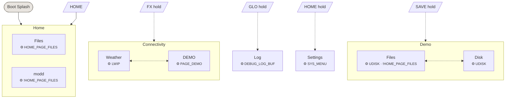

# modd UI Navigation

The diagram is generated from `firmware/src/ui/shells/modd/pages.c` and
`firmware/src/ui/shells/modd/controls.c`. Regenerate: `task docs:themes:ui:diagram`

- **Solid arrows** (`-->`) = button tap navigation
- **Dashed arrows** (`-.->`) = button hold navigation

<!-- ui-nav-diagram:start -->

<!-- ui-nav-diagram:end -->

## Controls

Written by hand: this shell hands its input to LVGL, so there are no knob maps for the
generator to read. The code is `shell.c` (`shell_knob`, `shell_button`) and `port.c`
(`lvt_enc_read`).

LVGL sees one input device, an encoder. SELECT turns it and OCT+ is its push button.
The widgets of the page on screen form the focus group.

| Control | Action |
|---------|--------|
| Select (enc) | Move the focus to the next or previous widget. In an open list: move the choice |
| OCT+ | The encoder's push: flip the focused switch, open the focused list, take the choice |
| OCT- | Back: close an open list and keep the old value |
| HOME | Home (hold: Config) |
| FX (hold) | Connectivity |
| GLO (hold) | Debug; hold again to return to the page before |

A page may take a control before LVGL does:

| Page | Select |
|------|--------|
| Home | Pick the track (T1..T4) |
| Connectivity | Focus |
| Config | Focus |
| Debug | Scroll the log back and forth |

The other encoders, PLAY and REC are not used by this shell. Its LEDs (`leds.c`): the
button of the page on screen, PLAY while playing, REC while armed, held note keys.
