# Felucca UI Navigation

Auto-generated from `firmware/src/ui/themes/felucca/pages.c` and `firmware/adapters/modd_controls.h`.

Regenerate: `task docs:ui-map -- felucca`

- **Solid arrows** (`-->`) = button tap navigation
- **Dashed arrows** (`-.->`) = button hold navigation
- **Dotted bi-arrows** (`<-..->`) = encoder cycling within a view
- **⚙ labels** = Kconfig guards (page compiled only when enabled)

```mermaid
%%{init: {"flowchart": {"curve": "linear"}} }%%
flowchart TD

    BOOT(["Boot Splash"]):::boot
    BOOT --> F_HOME

    F_HOME["HOME"]

    F_ENV["ENVELOPE"]

    F_LFO["LFO"]

    F_FX["EFFECTS"]

    F_SCL["SCALE"]

    F_EDIT["EDIT"]

    subgraph sg_GLO["Global"]
        F_MIXER["MIXER"]
        F_VOICE["VOICE"]
    end

    F_FILES["FILES<br/><small>⚙ UDISK</small>"]

    F_ARP["ARPEGGIO"]

    F_SEQ["STEP"]

    subgraph sg_CONN["Connectivity"]
        F_WIFI["WIFI<br/><small>⚙ WIFI | WIFI_NONFREE</small>"]
        F_WEATHER["WEATHER<br/><small>⚙ WIFI</small>"]
        F_BLE["BLUETOOTH<br/><small>⚙ BLE</small>"]
    end

    subgraph sg_SETTINGS["Settings"]
        F_SYS["SETTINGS<br/><small>⚙ SYS_MENU</small>"]
        F_ABOUT["ABOUT"]
        F_DEBUG["DEBUG<br/><small>⚙ DEBUG_LOG</small>"]
    end

    F_DEMO["DEMO"]

    %% Encoder: cycle pages within a view
    F_MIXER <-..-> F_VOICE
    F_WIFI <-..-> F_WEATHER
    F_WEATHER <-..-> F_BLE
    F_SYS <-..-> F_ABOUT
    F_ABOUT <-..-> F_DEBUG

    %% Buttons: tap navigates between views
    BTN_ARP[/"ARP"/] --> F_ARP
    BTN_EDIT[/"EDIT"/] --> F_EDIT
    BTN_ENV[/"ENV"/] --> F_ENV
    BTN_FX[/"FX"/] --> F_FX
    BTN_GLO[/"GLO"/] --> sg_GLO
    BTN_HOME[/"HOME"/] --> F_HOME
    BTN_LFO[/"LFO"/] --> F_LFO
    BTN_SAVE[/"SAVE"/] --> F_FILES
    BTN_SCL[/"SCL"/] --> F_SCL
    BTN_SEQ[/"SEQ"/] --> F_SEQ

    %% Buttons: hold navigates to secondary views
    BTN_FX_H[/"FX hold"/] -.-> F_DEMO
    BTN_GLO_H[/"GLO hold"/] -.-> sg_CONN
    BTN_HOME_H[/"HOME hold"/] -.-> sg_SETTINGS

    classDef boot fill:#E8E4DF,stroke:#6E675E,color:#333
```

<!-- ui-nav-diagram:start -->

<!-- ui-nav-diagram:end -->

<!-- ui-controls-table:start -->
## Global controls

Always active, handled by the shell or keyboard overlay:

| Control | Action |
|---------|--------|
| Presets (enc) | Cycle presets |
| Master (pot) | Master volume |
| OCT+ / OCT- | Octave shift |
| PLAY | Play/stop (page-specific on WIFI, WEATHER, BLE) |
| REC | Record toggle |
| Select (enc) | Cycle pages within current view (when no page claims it) |

## Controls per page

| Page | Select | Algo | Knob 1 | Knob 2 | Knob 3 | Knob 4 | Buttons |
|------|--------|------|--------|--------|--------|--------|---------|
| HOME | select | algorithm | knob1 | knob2 | knob3 | knob4 |  |
| ENVELOPE |  |  | ATK | DEC | SUS | REL |  |
| LFO |  |  | LFO | RATE | SHAPE | DELAY |  |
| EFFECTS |  |  | DST | CHO | DLY | REV |  |
| SCALE |  |  | ROOT | SCL | OCT | TRN |  |
| EDIT |  |  | knob1 | knob2 | knob3 | knob4 |  |
| MIXER |  | algorithm | knob1 | knob2 | knob3 |  |  |
| VOICE |  |  | VCE | HOLD | GLD | UNI |  |
| FILES | select |  |  |  |  |  |  |
| ARPEGGIO |  |  | MODE | TIME | RANGE | GATE |  |
| STEP |  |  |  |  |  |  |  |
| WIFI |  |  |  |  |  |  | PLAY, HOME |
| WEATHER |  |  |  |  |  |  | PLAY |
| BLUETOOTH | select |  |  |  |  |  | PLAY |
| SETTINGS |  |  |  |  |  |  | HOME |
| ABOUT |  |  |  |  |  |  |  |
| DEBUG | select |  |  |  |  |  |  |
| DEMO |  |  |  |  |  |  | OCTUP |
<!-- ui-controls-table:end -->
