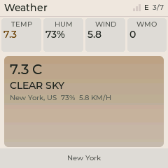
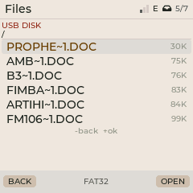
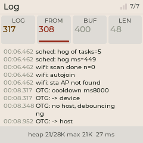
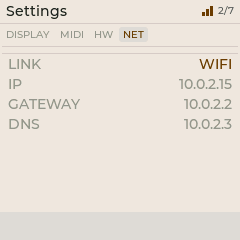
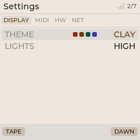
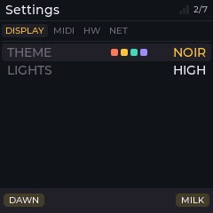
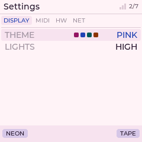

# modd Theme

The modd theme: the default theme, its pages, elements and controls drawn by [LVGL](https://lvgl.io) 9.6 from
its own widgets (labels, bars, a line, switches, buttons and plain objects) on LVGL's
default theme, in the modd palettes. No renderer of the other themes is compiled in, and
no font headers are generated: the type is LVGL's Montserrat.

| | |
|---|---|
| Kconfig | `CONFIG_UI_THEME_MODD` (UI theme choice) |
| Defconfig | The main theme. `modd`: production (audio, engines, storage, USB disk, REST API, WiFi on at boot, no weather). `modd_emu`: `modd` plus the emulator hooks and the weather page, for the API tests in fm1-live; never flashed |
| Tests | `task test:api`: `tests/ui/themes/modd/api/` (every page, every control of the map, palettes, hints, DEMO, audio, weather) |
| Build | `task build` (`modd`) or `task build -- --defconfig modd_emu` |
| Source | `firmware/src/ui/themes/modd/` |
| LVGL | `firmware/vendor/lvgl/` (v9.6.0, MIT), settings in the theme's `lv_conf.h` |
| LVGL manual | `docs/lvgl/` (same pin): read it before changing the theme, LVGL 8 differs |

Navigation and controls: [UI.md](UI.md).

## Screenshots

Captured from the emulator by `tools/codegen/gen_ui_screenshots.py`.
Regenerate: `task docs:themes:ui:screenshots`

<!-- theme-gallery:start -->
## Pages

| Home | Weather | Demo | Files | Disk | Log | WiFi |
|:----:|:----:|:----:|:----:|:----:|:----:|:----:|
|  |  |  |  |  |  |  |

## Settings

| DISPLAY | MIDI | HW | NET |
|:----:|:----:|:----:|:----:|
|  |  |  |  |

## Color Palettes

| 0 | 1 | 2 | 3 | 4 |
|:--:|:--:|:--:|:--:|:--:|
|  |  |  |  |  |

| 5 | 6 | 7 | 8 | 9 |
|:--:|:--:|:--:|:--:|:--:|
|  |  |  |  |  |
<!-- theme-gallery:end -->

## Pages

Every page has the same frame: a header (title; WiFi bars, `E`
for USB ethernet, the disk, page n/m), the page, and a footer with an OCT- pill, a context
text and an OCT+ pill.

| Page (name) | Opens with | Elements | Controls |
|------|-----------|---------|------|
| modd (HOME) | HOME | 4 track cards (engine, preset; the selected one in its colour with a full gauge), play / stop / record and tempo, `T1 ANALOG`, `P03  C Major  O+1`, level bar, envelope line, version; footer `modd` | SELECT track (stops at T1, T4); note keys play it |
| Settings (MENU) | HOME hold | tab bar (DISPLAY, MIDI, HW, NET ... as the build has them), rows with a switch or the value, the selected row raised; DISPLAY: THEME with the palette's four track colours and its name, LIGHTS; NET: LINK, IP, GATEWAY, DNS; footer: the previous and next value | SELECT tab, ALGO row, OCT+ / OCT- value |
| Weather (WX) | FX hold | TEMP, HUM, WIND, WMO cards; a sky in the track's colour with temperature, condition, city, humidity and wind; footer: the city | PLAY refreshes |
| DEMO | FX hold again | 7 screens: CARDS (the palette's tones), LIST, GRAPH, TEXT, EDIT, MODALS, TOAST; footer: the screen's name | SELECT screen (then the next page), K1-K4 |
| Files (FILES) | SAVE hold | `USB DISK` and the folder, 9 rows, the cursor's row raised; `USB Disk Off` / `No USB Disk` without a disk; footer BACK, the disk state, OPEN | ALGO cursor, OCT+ open, OCT- up / close |
| Disk (DISK) | SAVE hold again | DISK INFO: status, file system, capacity, volume, files, VID:PID, cluster; footer: the disk state | - |
| Log (LOG) | GLO hold, again back | LOG, FROM, BUF, LEN cards; `mm:ss.mmm` and the line, long lines wrap once; footer: LVGL's heap and the longest frame | ALGO scroll |

On every page: GLO tap shows the page's controls (its `.help_text`) over the page and badges
over the footer pills, a second tap or a page change hides them. Toasts from the firmware
(WiFi, weather, ethernet; `modd_toast.h`) show over the footer: a status for 3 s, an error
for 5 s or until the next button. The LEDs are driven by `leds.c`:
the page's button, PLAY and REC breathing while counting in or armed, held keys, the scale
dim, at the LIGHTS level. Not ported: the INSTR tab of Settings (`CONFIG_DOCK`, off in
`modd` and `modd_emu`).

## How it is put together

- **Library beside the unity build.** `tools/build/build.py` (`build_lvgl`) compiles
  `firmware/vendor/lvgl/src` into `build/<defconfig>/lvgl/liblvgl.a` and links it after
  `modd.o`. The first build of a defconfig compiles 483 files (about 3 minutes); after
  that only a change to `lv_conf.h` or the flags recompiles them.
- **Shell contract.** `ui_nav.c`, `modd_page_t` and
  `modd_controls_t` are shared with the other themes; `modd.c` calls the `shell_*` entry points. A page
  builds its widgets in `.enter`; `.draw` is unused because LVGL redraws what changed.
- **Display.** Partial rendering into two 240x24 strip buffers, sent by the existing LCD
  driver's DMA. LVGL draws the next strip while the last one is on the bus.
- **Input.** `shell.c`: a page's own knob and button handlers first;
  SELECT on a page that does not take it goes to the next page of the view; holds and taps
  from `controls.c`. LVGL has no input device: a page changes what
  its widgets show and LVGL draws it.
- **Palettes.** `palette.c` reads the palette list (generated into
  `build/<defconfig>/gen/modd/ui_palettes.h`), keeps the same stored setting
  (`sys_settings.ui_pal`) and the same derived tones. THEME is the selected track's colour.
  A change re-colours the theme's styles and LVGL's default theme in place.
- **Updates.** A page's `.status` reads the shared page data (`ui/page_data.c`) every frame
  and sets what changed; `lvt_text`, `lvt_text_color`, `lvt_bg_color` and `lvt_width` skip
  equal values, since LVGL redraws on every style set.
- **Settings.** `page_settings.c` shows every `SYS_MENU[]` item of a tab and steps it with
  the item's own `get`/`set`, so a new setting appears without theme code.

## Adding a page

1. Write `page_<name>.c`: an `enter` that calls `lvt_page_begin()` and adds widgets to the
   body it returns (`lvt_cards()` and `lvt_panel()` for the card layout), a `status` that
   updates them, `lvt_footer(left, center, right)`, and a `modd_page_t` with a `VIEW_*`
   and a `.help_text`.
2. Include it in `pages.c` and register it in `shell_register_pages()`.

Widgets that are switched off in `lv_conf.h` (`LV_USE_*`) cost no flash; switch on the
ones a new page needs.

## Measured cost

Full product configuration (`modd_defconfig`, audio and USB disk included), symbols of the UI
(2026-11-19, `.scratch/debug/lvgl-theme/ui_size_buckets.py`):

| | modd theme |
|---|---:|
| Flash (code + constants) | 196,312 (library 191,476, theme 4,836) |
| RAM `.data`/`.bss` | 7,787 |
| POOL (static buffers) | 55,808 (heap 32,768, strip buffers 23,040) |
| UI task stack | 12,288 |

- LVGL itself: 166,692 bytes of code and 25,651 of constants (two Montserrat sizes
  included); the theme's own code is about 4 KB.
- RAM the theme owns: 32,768 heap (`LV_MEM_SIZE`), 23,040 for the two strip buffers,
  12,288 for the UI task's stack, 524 of LVGL state.
- Measured in the emulator over the first four pages with a list open: heap peak 17,828 of 30,564 usable; stack peak 7,196. The Log page's footer shows
  the heap on a device.
- A whole-screen page change, emulator in strict timing: about 14 ms to build the page
  and 72 ms to draw it. The draw is as long as 240x240 pixels take at the 12 MHz SPI clock.

Not measured on hardware yet.
