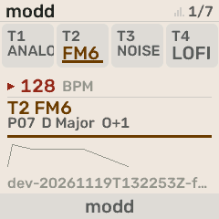
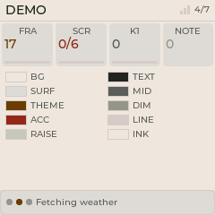
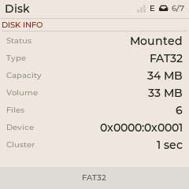
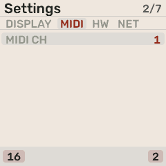
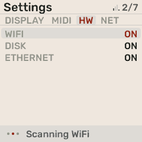
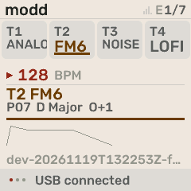
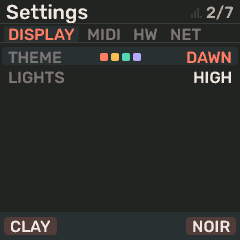
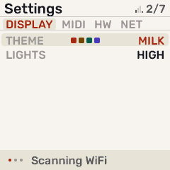
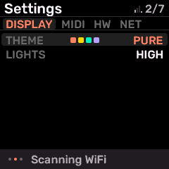
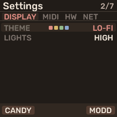

# modd Theme (MODD LEGACY) — Screenshot Gallery

No defconfig builds this theme any more: `modd` and `modd_emu` use the LVGL theme. To build
it, follow the MODD LEGACY note at the top of `configs/modd_emu_defconfig` (`CONFIG_UI_MODD=y`).
The screenshots below are the last ones captured.

All screenshots captured from the emulator by `tools/codegen/gen_ui_screenshots.py`.
Regenerate: `task docs:themes:ui:screenshots`

<!-- theme-gallery:start -->
## Pages

| Home | Weather | Demo | Files | Disk | Log | WiFi |
|:----:|:----:|:----:|:----:|:----:|:----:|:----:|
|  |  |  |  |  |  |  |

## Settings

| DISPLAY | MIDI | HW | NET |
|:----:|:----:|:----:|:----:|
|  |  |  |  |

## Color Palettes

| 0 | 1 | 2 | 3 | 4 |
|:--:|:--:|:--:|:--:|:--:|
|  |  |  |  |  |

| 5 | 6 | 7 | 8 | 9 |
|:--:|:--:|:--:|:--:|:--:|
|  |  |  |  |  |
<!-- theme-gallery:end -->
