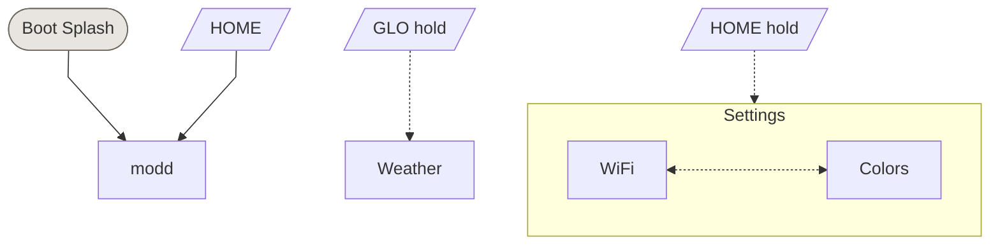

# modd UI Navigation

Auto-generated from `firmware/src/ui/themes/modd/pages.c` and `firmware/adapters/modd_controls.h`.

Regenerate: `task docs:ui-map -- modd`

- **Solid arrows** (`-->`) = button tap navigation
- **Dashed arrows** (`-.->`) = button hold navigation
- **Dotted bi-arrows** (`<-..->`) = encoder cycling within a view
- **⚙ labels** = Kconfig guards (page compiled only when enabled)

<!-- ui-nav-diagram:start -->

<!-- ui-nav-diagram:end -->

<!-- ui-controls-table:start -->
## Global controls

Always active, handled by the shell or keyboard overlay:

| Control | Action |
|---------|--------|
| Presets (enc) | Cycle presets |
| Master (pot) | Master volume |
| OCT+ / OCT- | Octave shift |
| PLAY | Play/stop (page-specific on WIFI, WEATHER, BLE) |
| REC | Record toggle |
| Select (enc) | Cycle pages within current view (when no page claims it) |

## Controls per page

| Page | Select | Algo | Knob 1 | Knob 2 | Knob 3 | Knob 4 | Buttons |
|------|--------|------|--------|--------|--------|--------|---------|
| modd |  |  |  |  |  |  |  |
| WiFi |  |  |  |  |  |  |  |
| Colors |  |  |  |  |  |  |  |
| Weather |  |  |  |  |  |  |  |
<!-- ui-controls-table:end -->
