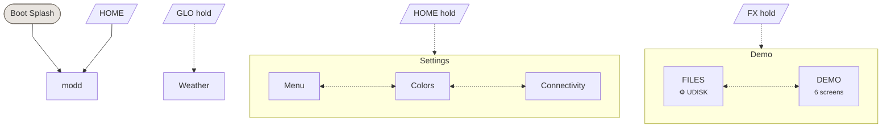

# modd UI Navigation

Auto-generated from `firmware/src/ui/themes/modd/pages.c` and `firmware/adapters/modd_controls.h`.

Regenerate: `task docs:ui-map -- modd`

- **Solid arrows** (`-->`) = button tap navigation
- **Dashed arrows** (`-.->`) = button hold navigation
- **Dotted bi-arrows** (`<-..->`) = encoder cycling within a view
- **⚙ labels** = Kconfig guards (page compiled only when enabled)

<!-- ui-nav-diagram:start -->

<!-- ui-nav-diagram:end -->

<!-- ui-controls-table:start -->
## Global controls

Always active, handled by the shell or keyboard overlay:

| Control | Action |
|---------|--------|
| Presets (enc) | Cycle presets |
| Master (pot) | Master volume |
| OCT+ / OCT- | Octave shift |
| PLAY | Play/stop |
| REC | Record toggle |
| Select (enc) | Cycle pages within current view (when no page claims it) |

## Controls per page

| Page | Select | Algo | Knob 1 | Knob 2 | Knob 3 | Knob 4 | Buttons |
|------|--------|------|--------|--------|--------|--------|---------|
| modd |  |  |  |  |  |  |  |
| Menu | scroll cursor |  |  |  |  |  |  |
| Colors |  |  |  |  |  |  |  |
| Connectivity | toggle wifi |  |  |  |  |  |  |
| Weather |  |  |  |  |  |  |  |
| FILES | scroll entries |  |  |  |  |  | SAVE: open dir, GLO: go up |
| DEMO | switch screen |  | per-screen | per-screen |  |  |  |
<!-- ui-controls-table:end -->

## DEMO screens

SELECT cycles 6 screens, K1-K4 adjust values per screen.

| Screen | Cards | Panel area | K1 | K2 |
|--------|-------|------------|----|----|
| CARDS | FRA, SCR, K1, NOTE | Theme color swatches | Counter (0-99) | -- |
| LIST | ITEMS, SEL | Scrollable 16-item list | List selection + auto-scroll | -- |
| GRAPH | BARS, FRAME, ANIM, STYLE | Animated bar chart | Counter (0-99) | -- |
| TEXT | FONT S/M/L, DEMO | Font samples, alignment, rounded rects | Counter (0-99) | -- |
| EDIT | EDIT, LEN, CUR, MAX | Inline text editor with blinking cursor | Move cursor | Change character |
| MODALS | MODALS, SEL, -, STYLE | Mock dialog overlays (YES/NO, OK, Text Input) | Select modal type | -- |
