# Felucca UI Navigation (Upstream)

Baseline reference for the original Felucca firmware UI.
Source: `firmware/upstream/felucca/firmware/src/` — `ui.c`, `ui_input.c`,
`ui_layer.c`, `params.c`, `panel.c`.

- **Solid arrows** (`-->`) = button tap navigation
- **Dashed arrows** (`-.->`) = button hold / layer open
- **Dotted bi-arrows** (`<-..->`) = pages within a family (SELECT PAGE or tap-cycling)

```mermaid
%%{init: {"flowchart": {"curve": "linear"}} }%%
flowchart TD

    BOOT(["Boot Splash"]):::boot
    BOOT --> FAM_HOME

    subgraph sg_HOME["HOME (FAM_TRK)"]
        MIXER["MIXER<br/><small>FAM_TRK · SC_TRK · GR_TRK</small>"]
        CLOCK["CLOCK<br/><small>FAM_TRK · SC_GLOBAL · BPM SWING CLK</small>"]
        MIXER <-..-> CLOCK
    end

    subgraph sg_ENV["Envelope (FAM_ENV)"]
        ENV["ENV<br/><small>ATK DEC SUS REL · GR_ADSR</small>"]
        ENV_DEST["ENV DEST<br/><small>FLT PIT SHP ESYNC</small>"]
        ENV <-..-> ENV_DEST
    end

    subgraph sg_LFO["LFO (FAM_LFO)"]
        LFO["LFO<br/><small>RATE WAVE PHASE FADE · GR_LFO</small>"]
        LFO2["LFO 2<br/><small>SYNC TRIG POL</small>"]
        LFO_DEST["LFO DEST<br/><small>PIT FLT SHP AMP</small>"]
        MOD["MOD<br/><small>slot SRC DST AMT · GR_MOD</small>"]
        LFO <-..-> LFO2
        LFO2 <-..-> LFO_DEST
        LFO_DEST <-..-> MOD
    end

    subgraph sg_FX["Effects (FAM_FX)"]
        FX["FX<br/><small>DIST CHOR DLY REV · GR_FX</small>"]
        SLICER["SLICER<br/><small>SLCR PAT RATE DEPTH · GR_SLCR</small>"]
        INSERT["INSERT<br/><small>TYPE A B C · GR_INS</small>"]
        INSERT2["INSERT 2<br/><small>MIX · GR_INS</small>"]
        DLY["DLY<br/><small>TIME FDBK COLOR MIX · SC_GLOBAL</small>"]
        REVERB["REVERB<br/><small>TYPE SIZE DAMP · SC_GLOBAL</small>"]
        CHORUS["CHORUS<br/><small>RATE DEPTH · SC_GLOBAL</small>"]
        FX <-..-> SLICER
        SLICER <-..-> INSERT
        INSERT <-..-> INSERT2
        INSERT2 <-..-> DLY
        DLY <-..-> REVERB
        REVERB <-..-> CHORUS
    end

    subgraph sg_SCL["Scale (FAM_SCL)"]
        SCL["SCL<br/><small>ROOT SCALE QUANT TRANS · GR_SCALE</small>"]
        CHORD["CHORD<br/><small>CHRD VOIC · GR_CHORD</small>"]
        SCL <-..-> CHORD
    end

    subgraph sg_EDIT["Edit (FAM_EDIT)"]
        EDIT1["EDIT 1<br/><small>E0 E1 E2 E3</small>"]
        EDIT2["EDIT 2<br/><small>E4 E5 E6 E7</small>"]
        FILTER["FILTER<br/><small>TYPE CUT RES KTR (ANALOG only)</small>"]
        LANES["LANES<br/><small>LN0..LN3 (DRUM only)</small>"]
        LANES2["LANES 2<br/><small>LN4..LN7 (DRUM only)</small>"]
        SLICES["SLICES<br/><small>GR_SLICES (SLICE only)</small>"]
        OPERATOR["OPERATOR<br/><small>GR_FMOP (FM6 only)</small>"]
        OP_ENV["OP ENV<br/><small>GR_FMENV (FM6 only)</small>"]
        OPERATOR2["OPERATOR 2<br/><small>GR_FMOP2 (FM6 only)</small>"]
        OP1_ENV["OP1 ENV<br/><small>FM6 · GR_ADSR</small>"]
        OP2_ENV["OP2 ENV<br/><small>FM6 · GR_ADSR</small>"]
        OP3_ENV["OP3 ENV<br/><small>FM6 · GR_ADSR</small>"]
        OP4_ENV["OP4 ENV<br/><small>FM6 · GR_ADSR</small>"]
        OP_LEVEL["OP LEVEL<br/><small>FM6 · 4 op levels</small>"]
        VOICE["VOICE<br/><small>VOICE GLIDE GLMODE PRIO</small>"]
        VOICE2["VOICE 2<br/><small>ALLOC DETUNE PAN MUTE</small>"]
        VOICE3["VOICE 3<br/><small>SPREAD ATSNS ATDST ATAMT</small>"]
        EDIT1 <-..-> EDIT2
        EDIT2 <-..-> FILTER
        FILTER <-..-> LANES
        LANES <-..-> LANES2
        LANES2 <-..-> SLICES
        SLICES <-..-> OPERATOR
        OPERATOR <-..-> OP_ENV
        OP_ENV <-..-> OPERATOR2
        OPERATOR2 <-..-> OP1_ENV
        OP1_ENV <-..-> OP2_ENV
        OP2_ENV <-..-> OP3_ENV
        OP3_ENV <-..-> OP4_ENV
        OP4_ENV <-..-> OP_LEVEL
        OP_LEVEL <-..-> VOICE
        VOICE <-..-> VOICE2
        VOICE2 <-..-> VOICE3
    end

    subgraph sg_GLO["Global (FAM_GLO)"]
        SONG["SONG<br/><small>GR_SONG</small>"]
    end

    subgraph sg_SAVE["Save (FAM_SAVE)"]
        USER["USER<br/><small>SLOT LOAD ERASE SAVE · GR_USER</small>"]
        PRESETS["PRESETS<br/><small>browser · GR_BROWSE</small>"]
        PHRASES["PHRASES<br/><small>pattern loader · GR_PATS</small>"]
        PROJECT["PROJECT<br/><small>SLOT _ LOAD SAVE · GR_SLOTS</small>"]
        TOOLS["TOOLS<br/><small>CLR SEQ INIT · GR_TOOLS</small>"]
        USER <-..-> PRESETS
        PRESETS <-..-> PHRASES
        PHRASES <-..-> PROJECT
        PROJECT <-..-> TOOLS
    end

    subgraph sg_ARP["Arpeggio (FAM_ARP)"]
        ARP["ARP<br/><small>MODE RATE OCT GATE · GR_ARP</small>"]
        ARP2["ARP 2<br/><small>SWING PROB HOLD ORDER</small>"]
        ARP <-..-> ARP2
    end

    subgraph sg_SEQ["Sequencer (FAM_SEQ)"]
        STEP["STEP<br/><small>SC_STEP · GR_ROLL</small>"]
        DETAIL["DETAIL<br/><small>SC_STEP · CHANCE RATCH NUDGE VEL</small>"]
        AUTOMATION["AUTOMATION<br/><small>locks list · GR_EVENTS</small>"]
        STEP <-..-> DETAIL
        DETAIL <-..-> AUTOMATION
    end

    MENU["MENU<br/><small>hierarchical settings<br/>tabs: AUDIO MIDI CONTROL SYSTEM ABOUT</small>"]:::menu

    %% Button taps (page_tap → open_family)
    BTN_HOME[/"HOME"/] --> sg_HOME
    BTN_ENV[/"ENV"/] --> sg_ENV
    BTN_LFO[/"LFO"/] --> sg_LFO
    BTN_FX[/"FX"/] --> sg_FX
    BTN_SCL[/"SCL"/] --> sg_SCL
    BTN_EDIT[/"EDIT"/] --> sg_EDIT
    BTN_GLO[/"GLO"/] --> sg_GLO
    BTN_SAVE[/"SAVE"/] --> sg_SAVE
    BTN_ARP[/"ARP"/] --> sg_ARP
    BTN_SEQ[/"SEQ"/] --> sg_SEQ

    %% Button holds
    BTN_HOME_H[/"HOME hold"/] -.-> MENU

    %% Layers (button held = combo mode)
    LY_FX["[FX] HOLD<br/><small>keys = effects<br/>K1-K4 = macros</small>"]:::layer
    LY_GLO["[GLO] SET<br/><small>PLAY = restart<br/>SELECT = tempo<br/>OCT- = undo</small>"]:::layer
    LY_SCL["[SCL] SET<br/><small>keys = ROOT note<br/>K1-K4 = ROOT SCL CHRD VOIC</small>"]:::layer
    LY_EDIT["[EDIT] SET<br/><small>keys = pick engine<br/>next key = INIT<br/>next = CLEAN INIT</small>"]:::layer
    LY_SEQ["[SEQ] TOOLS<br/><small>keys = seq tools<br/>K1-K4 = LEN DIV SWING GATE</small>"]:::layer
    LY_REC["[REC] SET<br/><small>keys = rec options</small>"]:::layer

    BTN_FX -.-> LY_FX
    BTN_GLO -.-> LY_GLO
    BTN_SCL -.-> LY_SCL
    BTN_EDIT -.-> LY_EDIT
    BTN_SEQ -.-> LY_SEQ
    BTN_REC[/"REC"/] -.-> LY_REC

    classDef boot fill:#E8E4DF,stroke:#6E675E,color:#333
    classDef menu fill:#F5EDE0,stroke:#8B7D6B,color:#333
    classDef layer fill:#E0E8F5,stroke:#6B7D8B,color:#333
```

<!-- ui-nav-diagram:start -->

<!-- ui-nav-diagram:end -->

## Physical controls

14 buttons, 7 encoders, 24 piano keys.

| ID | Label | Matrix default |
|----|-------|----------------|
| B_FX | FX | 2 |
| B_SCL | SCL | 3 |
| B_ENV | ENV | 4 |
| B_LFO | LFO | 5 |
| B_EDIT | EDIT | 6 |
| B_GLO | GLO | 7 |
| B_HOME | HOME | 8 |
| B_SAVE | SAVE | 9 |
| B_ARP | ARP | 10 |
| B_SEQ | SEQ | 11 |
| B_PLAY | PLAY | 12 |
| B_REC | REC | 13 |
| B_OCTDN | OCT- | 0 |
| B_OCTUP | OCT+ | 1 |

| ID | Label | Matrix default |
|----|-------|----------------|
| EN_SELECT | SELECT | enc 0 |
| EN_ALGO | ALGORITHM | enc 1 |
| EN_PRESET | PRESETS | enc 6 |
| EN_K1 | KNOB 1 | enc 2 |
| EN_K2 | KNOB 2 | enc 3 |
| EN_K3 | KNOB 3 | enc 4 |
| EN_K4 | KNOB 4 | enc 5 |

The mapping is overridable by HARDWARE CALIBRATION (hold OCT- + OCT+ at boot).

<!-- ui-controls-table:start -->
## Global controls

Always active regardless of page:

| Control | Action |
|---------|--------|
| Algorithm (enc) | Select track (1-4), clamps to NTRK |
| Presets (enc) | Browse/load presets (FX layer: pick effect for held key) |
| Select (enc) | BPM (default), configurable: BPM, PAGE, MODW, VEL via MENU > CONTROL > SELECT |
| OCT- / OCT+ | Octave shift (-3..+3), both pressed = reset to 0 |
| PLAY | Transport start/stop (GLO held: RESTART; SONG page: chain play) |
| REC | Arm recording (tap), held: opens [REC] SET layer |
| SAVE | Open SAVE family (tap), hold: UNDO (restore last sound load) |

## Button actions

| Button | Tap | Hold (700 ms) | Layer combos |
|--------|-----|---------------|--------------|
| HOME | HOME family (MIXER/CLOCK cycle) | Toggle MENU | - |
| ENV | ENV family | - | - |
| LFO | LFO family | MOMENTARY (temp tweak, reverts on release) | - |
| FX | FX family | - | [FX] HOLD: keys = effects, K1-K4 = macros |
| SCL | SCL family | - | [SCL] SET: keys = ROOT, K1-K4 = ROOT/SCL/CHRD/VOIC |
| EDIT | EDIT family | - | [EDIT] SET: keys = engine pick, INIT, CLEAN INIT |
| GLO | GLO family (SONG) | - | [GLO] SET: PLAY = restart, SELECT = tempo, OCT- = undo |
| SAVE | SAVE family | UNDO | - |
| ARP | ARP family | - | - |
| SEQ | SEQ family | - | [SEQ] TOOLS: keys = tools, K1-K4 = LEN/DIV/SWING/GATE |
| PLAY | Transport | - | - |
| REC | Arm (tap) | - | [REC] SET: keys = recording options |

## Context-sensitive EDIT button

| Context | EDIT action |
|---------|-------------|
| STEP page, step held | Clear step's parameter locks |
| STEP page, no step held | Clear step, advance cursor |
| AUTOMATION page | Delete the row's record |
| USER / PROJECT page | Rename the slot |
| FX layer, key held | Reset effect to default |

## Layers (button-held combos)

Each layer activates while its button is held. Keys, knobs 1-4 and other buttons
become combos. Double-tap (within 300 ms) locks the layer open.

| Layer | Button | Kind | Key map | Knob 1-4 | Footer hints |
|-------|--------|------|---------|----------|--------------|
| [FX] HOLD | FX | HOLD | Piano keys trigger effects | Effect macros | EFFECTS · MACROS |
| [GLO] SET | GLO | SET | PLAY = restart | Own four knobs | RESTART · UNDO · DONE |
| [SCL] SET | SCL | SET | Key = set ROOT note | ROOT SCL CHRD VOIC | ROOT · UNDO · DONE |
| [EDIT] SET | EDIT | SET | White keys = engines (up to 13); next = INIT; next = CLEAN INIT | - | ENGINE · UNDO · DONE |
| [SEQ] TOOLS | SEQ | SET | Keys = seq tools (copy, paste, reverse, ...) | LEN DIV SWING GATE | TOOLS · UNDO · DONE |
| [REC] SET | REC | SET | Keys = recording options | - | RECORDING · UNDO · DONE |

## LFO MOMENTARY

Hold LFO, turn a knob: the parameter changes temporarily. Release LFO: the
value reverts. With OCT+ held before releasing LFO: the new value is kept.

## SELECT encoder modes (MENU > CONTROL > SELECT)

| Mode | Behaviour |
|------|-----------|
| BPM (default) | SELECT = tempo; BPM LOCK: only with GLO held |
| PAGE | SELECT cycles pages within current family, one detent each |
| MODW | SELECT sends mod wheel |
| VEL | SELECT adjusts velocity |

## MENU system (HOME hold)

Hierarchical settings with tabs and rows. HOME hold toggles it; HOME tap inside
closes it. Tabs remembered across opens.

| Tab | Contents |
|-----|----------|
| AUDIO | TUNE, USB LEVEL, SCOPE, FX LATCH |
| MIDI | CHANNEL, ROUTE, CC, LEARN, AUTO SELECT, PROGRAM CHANGE |
| CONTROL | SELECT (BPM/PAGE/MODW/VEL), BPM LOCK, LEDS, ANIM IDLE |
| SYSTEM | USB SERIAL, HARDWARE CALIBRATION, ABOUT, CREDITS |

## Controls per page

| Page | Select | Algo | Knob 1 | Knob 2 | Knob 3 | Knob 4 | Buttons | Graph | Scope |
|------|--------|------|--------|--------|--------|--------|---------|-------|-------|
| MIXER | - | track | levels | - | - | - | - | GR_TRK | SC_TRK |
| CLOCK | - | - | BPM | SWING | CLOCK | - | - | - | SC_GLOBAL |
| ENV | - | - | ATK | DEC | SUS | REL | - | GR_ADSR | SC_TRACK |
| ENV DEST | - | - | ED_FLT | ED_PIT | ED_SHP | ESYNC | - | - | SC_TRACK |
| LFO | - | - | LRATE | LWAVE | LPHASE | LFADE | - | GR_LFO | SC_TRACK |
| LFO 2 | - | - | LSYNC | LTRIG | LPOL | - | - | - | SC_TRACK |
| LFO DEST | - | - | LD_PIT | LD_FLT | LD_SHP | LD_AMP | - | - | SC_TRACK |
| MOD | - | slot | M1SRC | M1DST | M1AMT | - | - | GR_MOD | SC_TRACK |
| FX | - | - | DIST | CHOR | DLY | REV | - | GR_FX | SC_TRACK |
| SLICER | - | - | SLCR | SLPAT | SLRATE | SLDEPTH | - | GR_SLCR | SC_TRACK |
| INSERT | - | - | ITYPE | IA | IB | IC | - | GR_INS | SC_TRACK |
| INSERT 2 | - | - | IMIX | - | - | - | - | GR_INS | SC_TRACK |
| DLY | - | - | DTIME | DFDBK | DCOLOR | DMIX | - | - | SC_GLOBAL |
| REVERB | - | - | RTYPE | RSIZE | RDAMP | - | - | - | SC_GLOBAL |
| CHORUS | - | - | CRATE | CDEPTH | - | - | - | - | SC_GLOBAL |
| SCL | - | - | ROOT | SCALE | QUANT | TRANS | - | GR_SCALE | SC_TRACK |
| CHORD | - | - | CHRD | VOIC | - | - | - | GR_CHORD | SC_TRACK |
| EDIT 1 | - | - | E0 | E1 | E2 | E3 | - | - | SC_ENGINE |
| EDIT 2 | - | - | E4 | E5 | E6 | E7 | - | - | SC_ENGINE |
| FILTER | - | - | FTYPE | E4 | E5 | E7 | - | - | SC_TRACK |
| LANES | - | - | LN0 | LN1 | LN2 | LN3 | - | - | SC_TRACK |
| LANES 2 | - | - | LN4 | LN5 | LN6 | LN7 | - | - | SC_TRACK |
| SLICES | - | - | keys | keys | - | - | - | GR_SLICES | SC_TRACK |
| OPERATOR | - | op select | - | - | - | - | - | GR_FMOP | SC_TRACK |
| OP ENV | - | - | - | - | - | - | - | GR_FMENV | SC_TRACK |
| OPERATOR 2 | - | - | - | - | - | - | - | GR_FMOP2 | SC_TRACK |
| OP1 ENV | - | - | FM1_ATK | FM1_DEC | FM1_SUS | FM1_REL | - | GR_ADSR | SC_TRACK |
| OP2 ENV | - | - | FM2_ATK | FM2_DEC | FM2_SUS | FM2_REL | - | GR_ADSR | SC_TRACK |
| OP3 ENV | - | - | FM3_ATK | FM3_DEC | FM3_SUS | FM3_REL | - | GR_ADSR | SC_TRACK |
| OP4 ENV | - | - | FM4_ATK | FM4_DEC | FM4_SUS | FM4_REL | - | GR_ADSR | SC_TRACK |
| OP LEVEL | - | - | FM1_LVL | FM2_LVL | FM3_LVL | FM4_LVL | - | - | SC_TRACK |
| VOICE | - | - | VOICE | GLIDE | GLMODE | PRIO | - | - | SC_TRACK |
| VOICE 2 | - | - | ALLOC | DETUNE | PAN | MUTE | - | - | SC_TRACK |
| VOICE 3 | - | - | SPRD | ATSNS | ATDST | ATAMT | - | - | SC_TRACK |
| SONG | - | chain | - | - | - | - | - | GR_SONG | SC_GLOBAL |
| USER | - | - | SLOT | LOAD | ERASE | SAVE | - | GR_USER | SC_GLOBAL |
| PRESETS | - | browse | - | - | - | - | - | GR_BROWSE | SC_GLOBAL |
| PHRASES | - | pattern | - | - | - | - | - | GR_PATS | SC_GLOBAL |
| PROJECT | - | - | SLOT | - | LOAD | SAVE | - | GR_SLOTS | SC_GLOBAL |
| TOOLS | - | - | CLR SEQ | INIT | - | - | - | GR_TOOLS | SC_GLOBAL |
| ARP | - | - | AMODE | ARATE | AOCT | AGATE | - | GR_ARP | SC_TRACK |
| ARP 2 | - | - | ASWING | APROB | AHOLD | AORDER | - | - | SC_TRACK |
| STEP | - | grid | - | - | - | - | - | GR_ROLL | SC_STEP |
| DETAIL | - | cursor step | CHANCE | RATCH | NUDGE | VEL | - | GR_ROLL | SC_STEP |
| AUTOMATION | - | locks list | - | - | - | - | - | GR_EVENTS | SC_TRACK |

## Page visibility rules

Some pages are hidden based on the selected engine:

| Condition | Pages hidden |
|-----------|-------------|
| Not DRUM engine | LANES, LANES 2 |
| Not ANALOG engine | FILTER |
| Not FM6 (DIGITAL) engine | OPERATOR, OP ENV, OPERATOR 2, OP1-4 ENV, OP LEVEL |
| Not SLICE engine | SLICES |
| FM4 mode (3-op FM6) | OP4 ENV, OP LEVEL (the 4th operator's) |
<!-- ui-controls-table:end -->
